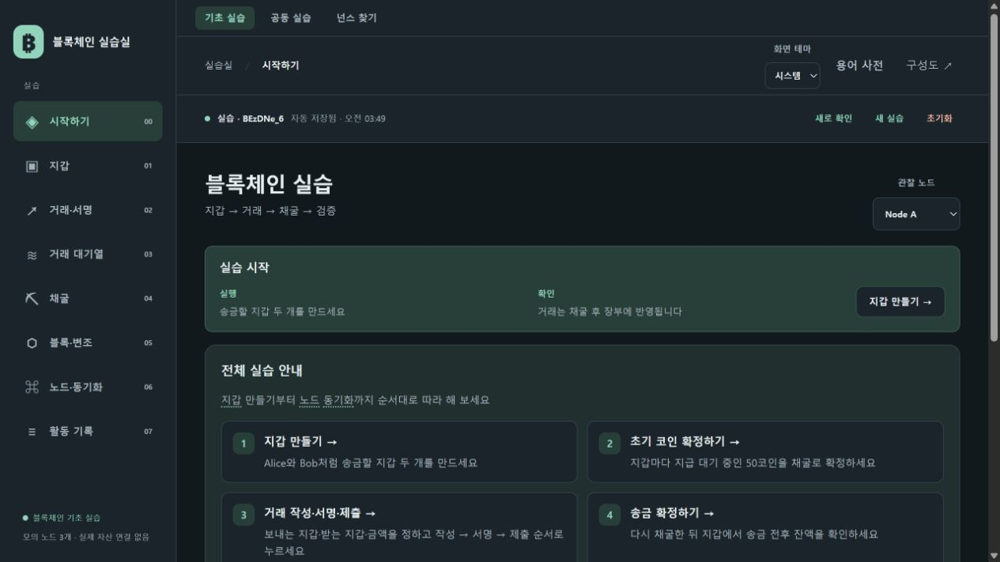

# 블록체인 실습실

지갑 만들기부터 송금·서명·채굴·노드 검증까지 직접 조작하며 배우는 팀 프로젝트

**[실습실 열기](https://blockchain-practice.onrender.com)** · **[최종보고서](docs/final-report.md)** · **[사용 안내](docs/user-guide.md)** · **[문서 목차](docs/README.md)**

## 강지호의 개인 수행 내역

**강지호는 기존 기초 실습 초안을 최종 온라인 서비스인 ‘블록체인 실습실’로 발전시키는 전반적인 고도화부터 검증·배포·최종 제출 자료 제작까지 모두 담당했습니다 아래 항목은 강지호가 수행한 개인 기여 내역입니다**

| 담당 범위 | 강지호가 수행한 내용 |
| --- | --- |
| 개인 개발 결과물 제공·통합 | 사전에 개인적으로 개발한 블록체인 교육 엔진과 React 화면을 팀 Flask 앱에 독립 사본으로 통합하고 UTXO·전자서명·수수료·거스름돈·보상 성숙 기능 연결 |
| 기초 실습·UI/UX 고도화 | 기존 초안의 화면·설명·조작 흐름을 보완하고 기초 6단계 안내를 구성 복잡한 통합 화면은 공개 메뉴에서 제외하고 필요한 기능을 기초 실습으로 선별·이식하며 테마·용어·상태 안내 정리 |
| 공동 실습·채굴·넌스 기능 확장 | 별명·역할·혼자 진행·실제 상태 기반 완료 가이드, 한 노드·세 모의 노드 채굴 비교, CPU·GPU·CPU+GPU 넌스 탐색과 CPU 전환, 선택형 로컬 Python·C 연산 연결 |
| 무료 서버 배포·기록 보존 | Render·Neon PostgreSQL 운영 환경 구축, 서버 재시작 후 저장 장부·공동 링크 보존, 서버 준비 안내와 자동 재연결 개선 |
| 검증·기술 설명 정리 | 코드·검사 기록·실제 조작 결과를 대조해 거래·서명·채굴·저장·복원 동작과 설명 오류를 점검하고 구현 범위·검증 한계 정리 |
| 최종 제출 자료 제작 | 최신 구현을 반영한 최종보고서·사용 안내·기술 문서 작성 및 정리, 실제 마우스 조작과 한국어 자막을 담은 4분 33초 시연 영상 제작·앱 반영, GitHub 소스·문서 관리 |

관련 산출물: [통합·저장 설계](docs/architecture.md) · [교육 엔진 이식 기록](experiments/blockchain-practice/education_engine/PROVENANCE.json) · [검증 기록](docs/test-results.md) · [최신 시연 영상](experiments/blockchain-practice/static/media/blockchain-practice-demo-20261117.mp4)

## 현재 상태

2026-11-17 기준 팀 앱은 `blockchain-practice` 브랜치의 `experiments/blockchain-practice/`에서 관리합니다 Render Free와 Neon Free PostgreSQL로 배포되어 PC를 꺼도 링크로 접속할 수 있습니다 휴대폰에서도 기본 웹 실습을 사용할 수 있으며, 서버가 준비 중이면 안내 후 자동으로 연결합니다

기초·공동 실습의 기록은 서버에 저장되며 서버 재시작 뒤에도 같은 접속 정보와 참여 링크로 이어갑니다 넌스 찾기 결과는 해당 브라우저에 최근 50개까지 저장합니다 브라우저 데이터를 지우거나 다른 기기를 사용하면 개인 실습의 접근 정보와 넌스 기록은 자동으로 따라오지 않습니다

| 화면 | 할 수 있는 일 |
| --- | --- |
| 기초 실습 | 지갑 → 거래·서명 → 대기열 → 채굴 → 변조·검증 → 노드 동기화, 한 노드 채굴과 세 노드 채굴 비교 |
| 공동 실습 | 이름으로 같은 방에 참여, A/B/C 역할 선택, 혼자 또는 팀원과 송금·채굴, 실제 진행에 따른 가이드 완료 표시 |
| 넌스 찾기 | 메시지와 난이도 입력, CPU·GPU·CPU+GPU 탐색, 해시 재검증과 결과 기록 |

공동 실습은 교사 없이 시작할 수 있습니다 새 실습에서는 팀마다 같은 초기 금액을 1~10000코인 중 선택하며 기존 기본 실습은 팀마다 100코인으로 시작합니다 기초 실습의 지갑당 지급 대기 50코인과 공동 실습의 UTXO 장부는 서로 다른 모델입니다

GPU 지원 여부는 접속한 기기와 브라우저에 따라 달라집니다 사용할 수 없으면 CPU로 전환하며 실제 사용한 장치를 표시합니다 Python·C 고급 모드는 준비된 로컬 PC에서 선택적으로 사용합니다

## 처음 시작하기

온라인 실습에는 설치가 필요하지 않습니다 [실습실](https://blockchain-practice.onrender.com)에서 기초 실습의 **전체 실습 안내** 6단계를 따라가세요 공동 실습은 참여 링크에서 별명을 입력하고, 혼자라면 **팀 A로 시작**한 뒤 **쉬운 실습** 안내를 따라갑니다

시작하기의 **시연 영상 보기**를 펼치면 최신 화면을 실제 조작한 **4분 33초** 자막 영상을 볼 수 있습니다

**[시연 영상 파일](experiments/blockchain-practice/static/media/blockchain-practice-demo-20261117.mp4)** · **[5분 이내 시연 대본](docs/demo-script.md)**



2026-11-17 운영 화면 캡처 · 앱 코드 `9fca791`

## 로컬 실행

Windows에서 Python 3.13과 Node.js 24를 준비한 뒤 저장소 루트에서 실행합니다

```powershell
cd experiments/blockchain-practice
.\Start-Team.cmd
```

기본 접속 주소는 `http://127.0.0.1:5003`이며 종료는 `Ctrl+C`입니다 실행기가 가상환경·화면 빌드·로컬 교사용 코드를 준비합니다 설치와 PC 전용 엔진의 자세한 조건은 [앱 실행 안내](experiments/blockchain-practice/README.md)를 확인하세요

## 코드와 문서

| 위치 | 내용 |
| --- | --- |
| `experiments/blockchain-practice/app.py`, `static/` | 기초 실습 API와 화면 |
| `experiments/blockchain-practice/education_engine/`, `education_api.py`, `team_rooms.py` | UTXO 엔진, 공동 실습과 소유권·참여 권한 |
| `experiments/blockchain-practice/frontend/` | 공동 실습·넌스 찾기·이전 통합 화면의 독립 사본 |
| `experiments/blockchain-practice/postgres_*.py`, `deployment_entrypoint.py` | PostgreSQL 저장과 운영 시작·종료 |
| `docs/` | 현재 팀 앱의 안내·설계·요구사항·보고서·검증 기록 |
| `docs/archive/personal-react/` | 문서 정리 전 개인 React 모델 문서와 과거 캡처 |

팀 앱 버전은 `experiments/blockchain-practice/frontend/package.json`과 `app.py`의 **3.0.0**, 가져온 교육 엔진 버전은 **3.2.0**입니다 루트 `package.json`의 **1.1.0**은 남아 있는 초기 개인 React 모델의 버전이며 팀 앱 버전과 구분합니다 개인 본체와 다른 브랜치의 원본은 독립적으로 관리합니다

[변경 이력](CHANGELOG.md) · [검증 결과](docs/test-results.md) · [배포·운영 안내](experiments/blockchain-practice/DEPLOYMENT.md) · [현재 배포 상태](docs/release-status.json)

## 확인한 범위

운영 코드 `9fca791`에서 Python 검사 총 235개 중 218개 통과·17개 조건부 건너뜀, 팀 화면 단위 검사 147개와 타입·린트·빌드를 확인했습니다 Linux 운영 컨테이너의 재시작·PostgreSQL 기록 복원 검사도 [CI에서 통과](https://github.com/jiho6367-design/mini-bitcoin-education/actions/runs/43961448887)했습니다 저장된 실습·공동 링크·참여 정보는 배포 전후 동일함을 대조했습니다

실제 자산이나 Bitcoin 네트워크에 연결하지 않는 교육용 모델입니다 모의 노드 비교를 실제 P2P 네트워크의 완전한 합의로 해석하지 않습니다 세부 차이와 검증 한계는 [모델 비교](docs/bitcoin-differences.md)와 [테스트 기록](docs/test-results.md)에 정리했습니다
