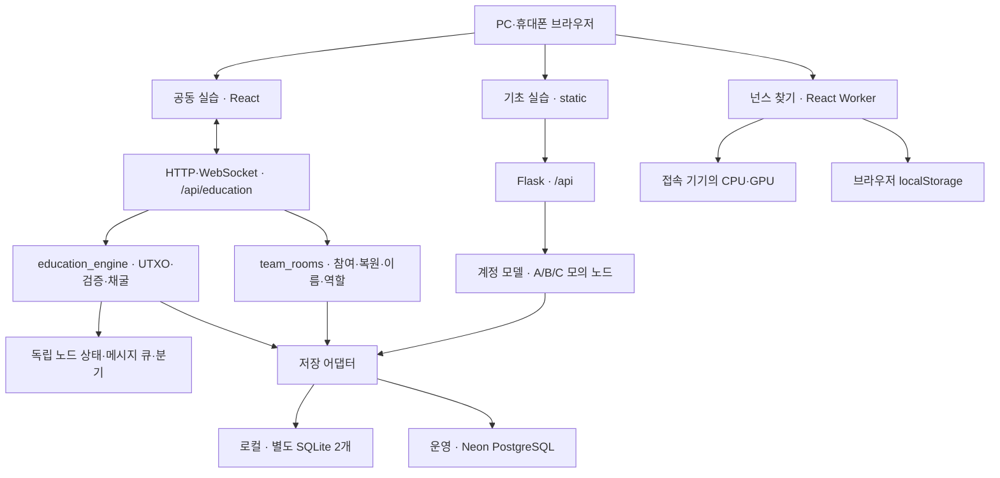

# 블록체인 실습실 설계

2026-11-17 기준 팀 브랜치 `blockchain-practice`의 구조입니다 실행 코드는 `experiments/blockchain-practice/`에 있으며 개인 프로젝트와 독립적으로 운영합니다 이전 React 개인 앱의 설계는 [보존한 원문](archive/personal-react/docs/architecture.md)에 있습니다

## 화면과 실행 경계

| 화면 | 경로 | 계산·상태의 주체 |
| --- | --- | --- |
| 기초 실습 | `/`, `/basic` | Flask의 계정 잔액·거래 순번 모델, 브라우저별 독립 실습 |
| 공동 실습 | `/?classroom=join&room=…` | Flask 교육 엔진의 UTXO 모델, 방 코드별 공유 장부 |
| 넌스 찾기 | `/hashcash` | 접속 기기의 Web Worker·Web Crypto·WebGPU, 브라우저별 결과 기록 |
| 이전 개인 실습·보관함 | `/advanced` | 팀 앱에 복사한 교육 엔진, 소유자별 접근 제한을 유지하는 호환 경로 |

공개 메뉴는 **기초 실습 · 공동 실습 · 넌스 찾기**입니다 `/advanced`는 메뉴에서 제외했지만 코드·API·저장 기록은 유지합니다 기초와 공동 실습은 거래 형식·서명·발행 규칙이 다른 별도 장부이며 자동 변환하거나 서로 합치지 않습니다

Flask가 정적 기초 화면과 빌드한 React 화면을 함께 제공하므로 별도 FastAPI 서버가 필요하지 않습니다 실제 인터넷 통신은 브라우저와 Flask 사이의 HTTP·WebSocket입니다 A/B/C는 한 서버 프로세스 안의 독립된 상태이며 서로 다른 PC에서 실행하는 Bitcoin P2P 노드가 아닙니다

## 기초 실습

주요 구현은 [`app.py`](../experiments/blockchain-practice/app.py), [`node.py`](../experiments/blockchain-practice/node.py), [`blockchain.py`](../experiments/blockchain-practice/blockchain.py), [`operations.py`](../experiments/blockchain-practice/operations.py)입니다

- 지갑은 secp256k1 키 쌍을 생성하며 주소는 공개키 바이트의 SHA-256입니다 거래는 수신 주소·금액·송신 공개키·시각·계정 거래 순번을 서명하고, 순번과 잔액을 검증합니다
- 새 지갑에는 주소당 한 번 **50코인 faucet 거래**를 접수합니다 블록에 포함되기 전에는 확정 잔액이 아니며, 기초 채굴 보상은 **10코인**입니다 공동 실습의 팀별 초기 배정과 다릅니다
- 블록은 교육용 텍스트 헤더·거래 ID의 Merkle root·단일 SHA-256을 사용합니다 난이도는 1~5이며, 변경은 높이별 규칙으로 기록해 과거 블록의 기준을 바꾸지 않습니다
- 채굴은 실제 Nonce와 해시를 계산하며 시작·한 번 계산·연속 계산·일시정지·중지를 지원합니다 작업 ID와 실습 revision을 검사해 오래된 요청이 새 작업을 바꾸지 못하게 합니다
- 기본은 한 노드 채굴입니다 세 노드 비교는 모두 온라인이고 유효한 같은 tip을 가질 때 시작하며 A/B/C가 순서를 번갈아 실제 해시를 한 번씩 계산합니다 첫 발견 블록을 전달하고 나머지 후보를 중지합니다 이 비교는 세 PC의 성능 측정이 아닙니다
- 각 노드는 별도 체인·Mempool·잔액 상태를 보관합니다 수신 시 검증하고, 단절·변조 이후 동기화에서는 유효성과 누적 작업량을 비교해 복구합니다

브라우저는 [`static/app.js`](../experiments/blockchain-practice/static/app.js)에서 화면·입력·선택 거래와 비동기 작업을 관리합니다 서버 준비 중에는 상태를 조회하며 자동 연결하지만, 결과가 불확실한 거래·채굴·저장 요청을 자동 재실행하지 않습니다

## 교육 엔진과 공동 실습

[`education_engine`](../experiments/blockchain-practice/education_engine/README.md)은 개인 프로젝트에서 독립 복사한 Python 규칙·서비스입니다 출처 커밋과 당시 파일 해시는 [`PROVENANCE.json`](../experiments/blockchain-practice/education_engine/PROVENANCE.json)에 보존합니다 개인 소스나 개인 DB를 런타임에 가져오지 않습니다

`core/`는 키·서명·UTXO·블록·노드별 검증을 담당합니다 `service/`는 실행 세션·채굴 작업·경쟁·교실 권한·체크포인트·보관함을 담당합니다 [`education_api.py`](../experiments/blockchain-practice/education_api.py)가 HTTP·WebSocket 전송과 브라우저 소유권을 연결하고 [`team_rooms.py`](../experiments/blockchain-practice/team_rooms.py)가 교사 없는 팀 참여와 같은 링크 복원을 추가합니다

UTXO 거래는 확정 입력 선택 → 거스름돈·수수료 계산 → 전자서명 → 검증 → Mempool 접수 → 실제 PoW → 수신 노드 검증 순서로 진행합니다 대기 거래가 입력 하나를 쓰면 그 입력 전체를 예약하므로 확정 잔액이 있어도 사용 가능액은 0일 수 있습니다 블록 반영 후 거스름돈을 다시 사용할 수 있습니다

공동 실습은 기본적으로 A/B/C에 **각 100코인**을 Genesis에서 한 번 배정합니다 새 실습은 팀별 동일 초기 금액을 1~10000 정수로 정할 수 있습니다 기존 링크 입장·재접속·참가자 추가는 재발행하지 않습니다 채굴 보상은 팀 송금 지갑과 별도의 보상 지갑에 **50+수수료**로 쌓이고 100블록 성숙 규칙을 적용합니다

교육 엔진의 난이도는 실습별 1~4입니다 고정 순서 JSON 헤더에 단일 SHA-256을 적용하고 `hash <= target`을 검사합니다 노드별 FIFO 전달 큐와 별도 체인·UTXO·Mempool을 보관하며, 유효한 분기의 누적 작업량이 더 클 때 재구성하고 가능한 분리 거래를 다시 검토합니다 한 노드 채굴과 세 채굴자 경쟁은 별도 실행 방식입니다

팀원은 별명으로 입장하고 비어 있는 A/B/C 역할을 맡습니다 자기 팀 거래 서명은 대표 권한을 확인하고 채굴·전파 등 공통 조작은 다른 팀원도 실행할 수 있습니다 시작한 사람이나 교사가 접속해 있을 필요는 없습니다 가이드는 현재 선택한 거래·예약 입력·후보·노드별 실제 블록 포함 여부를 읽어 완료와 다음 동작을 표시하며 안내 이동 자체로 거래를 실행하지 않습니다

## 저장과 재접속

| 데이터 | 로컬 기본 | 운영 PostgreSQL |
| --- | --- | --- |
| 기초 지갑·거래·체인·자동 저장 실습 | `instance/practices.sqlite3` | `team_basic` |
| 교육 엔진·공동 방·보관함·참가자 소유 정보 | `instance/education.sqlite3` | `team_education` |
| 배포 쓰기 권한 제어 | 해당 없음 | `team_control` |
| 넌스 발견 기록 | 해당 브라우저의 최근 50개 | 서버에 기록하지 않음 |

운영은 **Render Free Docker 한 인스턴스 + Neon Free PostgreSQL**입니다 `TEAM_DATABASE_URL` 설정 시 두 장부는 외부 DB를 사용하며 임시 컨테이너 파일을 영속 저장으로 취급하지 않습니다 저장 실패는 성공으로 응답하지 않고 지원하는 변경 경계에서 메모리도 원복합니다 새 배포의 초기화가 성공한 뒤 쓰기 권한을 넘겨받아 이전 프로세스의 낡은 상태 덮어쓰기를 막습니다

실행 중인 방과 채굴 스케줄러는 프로세스 메모리에 있으므로 Gunicorn **worker 1개·thread 64개**를 사용합니다 여러 worker나 여러 서버로 자동 확장하는 구조가 아닙니다 공동 기본 방과 추가 방 최대 3개를 동시에 유지하며 접속자가 없는 추가 방은 저장·일시정지 후 메모리에서 비울 수 있습니다 링크와 DB 기록은 유지합니다

서버 재시작 후 같은 링크에서 장부와 별명을 복원하고, 같은 브라우저의 서명된 소유 쿠키로 새 참가 권한을 발급합니다 예전 임시 토큰·역할 점유·실행 중 계산은 재사용하지 않으므로 역할을 다시 선택하고 계산을 재개합니다 개인 보관함 접근은 브라우저 소유권에 묶이며 쿠키 삭제 후 자동 복구하는 계정 로그인 기능은 없습니다 교육용 개인키도 서버 저장 기록에 포함됩니다

`KAKAO_PRACTICE_DB`, 소유 쿠키, DB 접두어와 브라우저 저장 키의 옛 이름은 호환 식별자입니다 프로젝트명을 바꾼다는 이유로 바꾸지 않습니다 로컬 두 DB에 같은 경로를 지정하는 구성도 거부합니다

## 이전 주소 연결

현재 주소는 [블록체인 실습실](https://blockchain-practice.onrender.com)입니다 이전 `kakao-team-flask.onrender.com`은 `TEAM_SITE_MODE=transfer`인 연결 전용 서버이며 DB·교육 런타임을 만들지 않습니다

[`site_transfer.py`](../experiments/blockchain-practice/site_transfer.py)는 정확히 설정한 두 HTTPS 출처 사이에서 기존 소유 쿠키와 허용한 브라우저 기록만 이전합니다 암호화한 POST, 180초 만료와 일회용 nonce를 사용하고, 이미 새 주소에서 사용 중인 소유 정보와 기록은 덮어쓰지 않습니다 주소 변경은 장부 복제나 두 서버의 동시 쓰기가 아닙니다

## 넌스 찾기와 선택 PC 엔진

[`frontend/src/hashcash`](../experiments/blockchain-practice/frontend/src/hashcash/runner.ts)는 `SHA256(UTF8(메시지 + 10진수 넌스))`를 계산합니다 넌스 범위는 uint64이며 공백·줄바꿈도 입력에 포함합니다 난이도는 앞의 16진수 0 개수입니다 이 결과는 블록을 만들거나 기초·공동 지갑 잔액을 바꾸지 않습니다

자동 모드는 WebGPU 장치와 알려진 해시를 실제 검증한 뒤 GPU를 사용합니다 CPU는 Web Crypto, CPU+GPU는 겹치지 않는 구간을 동시에 계산합니다 WebGPU 미지원·준비/검증 실패·계산 오류·UTF-8 메시지 35바이트 초과 시 브라우저 CPU로 전환합니다 실패한 GPU 배치의 검증되지 않은 범위는 CPU에서 다시 계산합니다 GPU 완료 배치 수는 발견 이후 계산도 포함하며 최소 넌스 발견이나 항상 더 빠른 실행을 보장하지 않습니다

Python/C PC 모드는 선택 사항입니다 명시적으로 켠 로컬 서버에서만 실제 루프백 접속과 literal loopback Host를 확인하고 사용합니다 Render에서는 항상 꺼집니다 사용 불가를 시작 전에 확인하면 브라우저 CPU로 전환하지만, 이미 처리됐을 수 있는 요청이나 실행 중 연결 오류는 중복 계산을 시작하지 않고 상태 확인을 안내합니다 CUDA·C 라이브러리는 사용자가 작업을 시작할 때만 로드하며 설치도 자동 수행하지 않습니다 자세한 조건은 [PC 엔진 안내](../experiments/blockchain-practice/native_hashcash/README.md)에 있습니다

## 검증과 한계

실제 규칙·저장·재시작·권한 검사는 팀 폴더의 `tests/`, 브라우저 흐름은 `tests/browser/`와 `frontend/` 검사에서 확인합니다 실행 결과와 운영 범위는 [검증 기록](../experiments/blockchain-practice/VERIFICATION.md), 재배포·백업은 [배포 안내](../experiments/blockchain-practice/DEPLOYMENT.md)를 따릅니다

암호학적 해시·서명·PoW 계산은 실제 수행하지만 네트워크·발행·주소·키 보관·직렬화·합의 규칙은 교육용입니다 Bitcoin 노드 호환성, 실제 자산 보관, 무제한 동시 접속, 무료 플랫폼의 상시 가용성을 보장하지 않습니다
