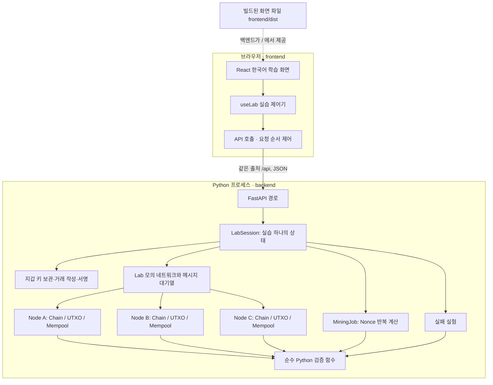

# 설계

## 책임 분리

화면은 React·TypeScript·Vite로 만든 얇은 클라이언트다. 서명·검증·해시 코드를 갖지 않고, 백엔드가 보낸 실습 상태를 그리며 사용자의 조작을 요청으로 보낸다. 규칙은 모두 Python 백엔드에 한 번만 구현한다. `core/`는 FastAPI에 의존하지 않는 순수 Python이고, `service/`는 실습 하나의 상태를 보관하며, `api/`는 HTTP 경로와 오류 형식, 빌드된 화면 파일 제공을 담당한다.

실행 방식은 두 가지이며 화면 코드는 같다.

- **백엔드 하나(실행·시연용).** 화면을 `npm run build`로 빌드해 두면 백엔드가 `frontend/dist`의 파일을 `/`에서, API를 `/api`에서 함께 제공한다. 실행 중인 서버는 Python 프로세스 하나다. 빌드 결과는 저장소에 넣지 않으므로 빌드에는 Node.js가 필요하다.
- **서버 두 개(화면 수정용).** Vite 개발 서버가 화면을 제공하고 `/api` 요청을 백엔드로 전달한다. 화면 소스를 고치면 바로 반영된다. 미리보기 서버(`npm run preview`)도 같은 전달 설정을 쓴다.

앱의 블록체인 상태는 백엔드 프로세스의 메모리에 있다. DB는 없으며, 백엔드를 다시 시작하면 모든 실습이 사라진다. 화면은 실습 ID를 React 상태에만 보관하므로 새로고침하면 새로운 실습이 시작된다. 영속 저장의 예외는 브라우저에 두는 화면 테마 선택값뿐이다. 지갑·개인키·거래·체인·채굴 작업을 영속화하지 않는다.

## 주요 데이터와 직렬화

- Wallet: 이름·개인키·압축 공개키·주소. 잔액은 저장하지 않는다.
- UnsignedTransaction: `version=1`, `sessionId`, `inputs[{txId, outputIndex}]`, `outputs[{address, amount}]`, `publicKey`.
- Transaction: 위 필드에 64바이트 compact ECDSA `signature`와 `id` 추가.
- UTXO: `txId:outputIndex`를 키로 사용하고 주소·금액을 저장한다. 양의 안전한 정수만 사용한다.
- Block: 실습 ID·높이·이전 해시·거래 목록 해시·시각(ms)·난이도·Nonce·거래 목록·블록 해시. Genesis에만 초기 배정 `allocations`가 있다.
- NodeState: 각자의 체인 배열·UTXO 사전·Mempool 배열·처리한 페이로드 지문 집합·최근 검증 결과. 다른 노드의 자동 수신이 선택 노드의 실패 설명을 덮어쓰지 않는다.
- NetworkMessage: 순번·출발·도착·종류·페이로드. 처리 전 대기열, 처리 후 이벤트 기록으로 상태를 구분한다.
- ValidationResult: `valid`, `code`, 한국어 `message`, 단계별 `steps`.
- TransactionLesson: 제출 노드·작성 원문·서명 원본·검증한 사본·입력 UTXO 스냅샷·서명 원문과 그 해시·실제 검증 결과와 관찰 단계. 화면이 보관하는 거래 추적 정보이며 검증 권한이나 원장의 일부가 아니다.

Python 내부에서는 거래·블록을 수정할 수 없는(frozen) 객체로 두고 필드 이름을 `tx_id`처럼 쓴다. API와 문서의 JSON은 위와 같은 camelCase 이름을 사용한다. "안전한 정수"는 브라우저가 정확히 표현할 수 있는 범위(절댓값 2^53−1 이하)의 정수이며, 참/거짓 값이나 `30.0` 같은 실수는 정수로 받지 않는다.

서명 원문은 고정 순서 배열 `[version, sessionId, 입력 튜플 배열, 출력 튜플 배열, publicKey]`를 공백 없이 쓴 JSON이다. UTF-8 바이트를 SHA-256으로 한 번 해시한 후, 추가 해시 없이 그 값에 ECDSA로 서명한다(`Prehashed`). 서명은 같은 키와 원문에서 항상 같은 값이 나오는 결정적 방식(RFC 6979)이고, `(r, s)`의 s는 작은 쪽 값으로 고정한다. 검증할 때 큰 쪽 s와 범위를 벗어난 값은 거부한다. 거래 ID는 `[서명 원문 문자열, signature]`를 직렬화한 SHA-256이다. 출력 순서와 입력 순서는 의미를 가지며 바꾸면 서명이 달라진다. `id` 자체는 자기 해시의 입력에 넣지 않는다.

주소는 `mini_` + 공개키 바이트의 SHA-256이다. Bitcoin 주소와 호환되지 않는다. 블록 해시는 `[sessionId,height,previousHash,transactionsHash,timestamp,difficulty,nonce]`의 JSON을 SHA-256으로 계산한다. 거래 목록 해시에는 거래 ID뿐 아니라 각 거래의 실제 필드와 서명도 포함하며, 객체 키 순서에 의존하지 않게 고정 배열로 정규화한다. Genesis의 거래 목록 해시만은 예외로, 초기 배정 목록을 `[{"address":…,"amount":100}]` 형태의 JSON으로 해시한다.

이 형식은 1.1.0의 TypeScript 구현과 같다. 같은 고정 입력에서 주소·서명·거래 ID·블록 해시·검증 결과가 일치하는지를 기준값 파일(`backend/tests/vectors/ts-core-v1.json`)로 검사한다.

## Genesis와 거래 처리

1. 지갑 두 개를 만든다. 새 실습 ID를 생성하고 Alice에게 100을 배정한다.
2. Genesis는 실습의 신뢰 시작점으로 별도 보관한다. 세 노드는 동일한 내용에서 시작하지만 체인·UTXO·Mempool을 각자 가진다.
3. 초기 UTXO의 참조는 Genesis 해시와 배정 출력 번호다. 일반 거래·coinbase가 아닌 교육용 특례다.
4. 송금 시 해당 지갑의 확정 UTXO를 outpoint 순서대로 고르고, 다른 대기 거래가 예약한 입력은 제외한다.
5. 모든 입력은 한 지갑의 소유여야 한다. 수신자 출력과 필요 시 거스름돈을 만들며, 입력·출력 합계는 같아야 한다.
6. 서명·검증 성공 후 Mempool에 추가한다. 이때 확정 UTXO는 바꾸지 않는다.

서명 검사는 공개키로 수행한다. 개인키는 백엔드의 지갑 목록에만 있으며 서명 함수만 사용한다. 실습 상태 응답·노드 상태·메시지·이벤트에는 넣지 않고, 화면의 **교육용 개인키 펼쳐 보기**를 열 때만 전용 경로로 한 지갑의 개인키를 보낸다. 사용자의 기기에서 서명하는 실제 지갑과 달리 서버가 키를 보관하는 구조이며, 개인키의 암호학적 생명주기 보장을 제공하는 실제 지갑 구현은 아니다.

## 블록 처리의 원자성

`validate_block`은 형식→연결→시각→고정 난이도→실제 거래 목록 해시→헤더 해시→PoW→모든 거래를 검사한다. 거래마다 원래의 확정 UTXO와 블록 내 사용 입력 집합을 사용해 이중 지출을 막는다. 같은 블록의 미확정 출력을 다시 쓰는 거래는 지원하지 않는다.

모든 검증에 성공한 경우에만 UTXO 사본에 거래를 적용하고 체인·UTXO를 함께 반영한다. 블록 뒤쪽 거래가 실패해도 앞쪽 거래가 부분 반영되지 않는다. 이후 남은 Mempool을 새 UTXO로 재검증하여 확정·충돌 거래를 제거한다. 블록 거래가 Mempool에 없다는 이유로 거부하지 않는다.

`validate_chain`은 신뢰 Genesis와의 일치부터 확인하고 UTXO를 처음부터 재구축하며 모든 후속 블록을 검사한다.

## 모의 네트워크

A/B/C는 상태를 공유하지 않는다. 송신 노드는 자기 검증을 통과한 거래·블록을 다른 두 노드에 전체 연결 방식으로 전송한다. 거래·블록 객체는 수정할 수 없으므로 한 노드가 받은 값을 바꿔 다른 노드를 오염시킬 수 없다. 전달받은 데이터는 수신 노드가 검증한다. 처리한 전체 페이로드 지문을 기억하므로 동일 메시지는 중복 저장하지 않는다. 같은 ID를 주장하는 다른 내용은 별도로 검증된다.

자동 전달은 700ms마다 한 메시지, 수동 전달은 버튼 한 번에 한 메시지다. 두 경우 모두 화면이 `deliver-next` 요청을 보내고 백엔드는 대기열의 첫 메시지 하나를 처리한다. 백엔드는 스스로 메시지를 전달하지 않는다. 새 실습은 수동으로 시작한다. 이는 인터넷 지연의 측정값이 아닌 관찰용 시간 간격이다. 이벤트는 최근 200개까지 보관하고 화면은 최근 20개를 표시한다. `lastDelivery`는 실제 처리한 메시지와 검증 결과를 보관한다. `network.ts`는 출발·도착으로 경로를 계산하며 큐 선택은 경로 미리보기만 바꾸고 FIFO 순서를 바꾸지 않는다.

실습 하나에는 한 번에 하나의 채굴 작업만 허용한다. 이전 블록 전달이 남았거나 노드들의 tip이 다르면 새 후보 생성을 거부한다. 노드 단절·동시 채굴·고아 블록·재구성을 구현하지 않으므로 최장/최대 작업량 체인 선택을 흉내 내지 않는다.

세 노드는 백엔드 프로세스 하나 안의 독립 상태다. 화면과 백엔드를 나누었다고 해서 노드가 서로 다른 프로세스나 장치에서 통신하는 분산 시스템이 된 것은 아니다.

## HTTP API

화면은 어느 실행 방식에서나 같은 출처의 `/api`만 호출한다. 백엔드 하나로 실행하면 화면과 API가 실제로 같은 서버에 있고, 서버 두 개로 실행하면 Vite 개발·미리보기 서버가 `/api`를 `http://127.0.0.1:8000`의 백엔드로 전달한다. 그래서 브라우저는 외부 주소에 요청하지 않으며 CORS 설정도 필요 없다. 요청·응답은 JSON이고 필드 이름은 위 데이터 구조와 같다.

백엔드는 `/api` 경로를 먼저 찾고, 그 밖의 경로만 빌드된 화면 폴더에서 찾는다. 화면 폴더는 기본적으로 저장소의 `frontend/dist`이며 `--frontend` 옵션이나 `MINI_BITCOIN_FRONTEND_DIR` 환경 변수로 바꿀 수 있다. 그 폴더에 `index.html`이 없으면 화면 없이 API만 제공하고(`--api-only`로 직접 지정할 수도 있다), 시작할 때 어느 쪽인지 알린다. HTML 파일은 브라우저가 매번 서버에 확인하도록 응답해, 다시 빌드한 화면이 새로고침으로 바로 보인다. 화면 폴더 밖의 파일은 제공하지 않는다.

| 메서드와 경로 | 역할 |
|---|---|
| `GET /api/health` | 상태와 백엔드 버전 |
| `POST /api/labs` | 예제 실습 시작(`mode: example`), 또는 지갑을 직접 만드는 준비 단계 열기(`mode: manual`) |
| `GET /api/labs/{id}` · `DELETE /api/labs/{id}` | 실습 상태 조회 · 초기화 |
| `POST /api/labs/{id}/wallets` | 지갑 생성(Alice, Bob, 학생 N) |
| `GET /api/labs/{id}/wallets/{address}/private-key` | 한 지갑의 개인키 조회 |
| `POST /api/labs/{id}/start` | 준비 단계의 지갑으로 실습 시작 |
| `POST /api/labs/{id}/nodes/{node}/drafts` | 미서명 거래 작성. 거래·입력 UTXO·서명 원문·원문 해시 반환 |
| `POST /api/labs/{id}/wallets/sign` | 거래의 공개키에 해당하는 지갑으로 서명 |
| `POST /api/labs/{id}/nodes/{node}/transactions` | 제출. 검증 결과와 실습 상태 반환 |
| `POST /api/labs/{id}/messages/deliver-next` | 대기열의 첫 메시지 전달 |
| `POST /api/labs/{id}/mining` | 채굴 작업 시작(노드·방식·한 번 계산 여부) |
| `POST /api/labs/{id}/mining/{jobId}/{tick,pause,resume,step,stop}` | 채굴 작업 진행·제어 |
| `POST /api/labs/{id}/nodes/{node}/experiments/{forged-signature,double-spend,invalid-pow-block,tamper}` | 실패 실험 네 가지 |

**실습 상태(snapshot).** 조회와 상태를 바꾸는 요청은 실습 전체 상태를 돌려준다. 실습 ID·수정 번호(`revision`)·지갑의 공개 정보·Genesis·난이도·목표값·노드별 체인·UTXO·Mempool·최근 검증 결과·메시지 대기열·이벤트·최근 수신·채굴 상태를 담는다. 화면이 직접 계산하던 값은 백엔드가 계산해 함께 보낸다: 노드별 체인 전체 검증 결과, 지갑별 확정 잔액과 송금 가능 잔액, 대기 거래가 예약한 입력 목록, 채굴을 시작할 수 있는지 여부. 대기열 메시지는 순번·출발·도착·종류만 보내고 페이로드는 보내지 않는다.

**검증 실패와 오류의 구분.** 거래·블록이 규칙에 맞지 않아 거부된 것은 오류가 아니다. HTTP 200과 `validation`(`valid: false`, 코드, 한국어 설명, 단계)으로 응답한다. 형식이 엉망인 값도 그대로 검증 규칙에 넘겨 `FORMAT` 결과로 설명한다. 요청 자체를 처리할 수 없을 때만 `{"error": {"code", "message"}}`로 응답한다: 잘못된 입력 400(금액·수신 주소·난이도 등), 현재 상태와 맞지 않는 요청 409(대기 거래 없음, 진행 중인 채굴, 이전 블록 전달 대기 등), 없는 실습 404.

**실습의 수명.** 실습은 ID마다 따로 보관한다. 초기화는 `DELETE`로 지운다. 탭을 닫아 버려진 실습이 쌓이지 않도록 최대 32개만 보관하고, 새 실습을 만들 때 가장 오래 쓰지 않은 것부터 정리한다. 정리되었거나 백엔드 재시작으로 사라진 실습에 요청하면 404와 함께 초기화 후 다시 시작하라는 안내를 보낸다. 요청은 실습마다 한 번에 하나씩 처리한다(lock).

## 채굴 작업

채굴 계산은 백엔드의 `MiningJob`이 수행한다. 백엔드는 스레드나 타이머로 스스로 돌지 않는다. **화면이 계산 요청(tick)을 보낼 때마다** 다음 묶음의 Nonce를 실제로 계산하고 결과를 돌려준다. 응답의 `nextTickInMs`가 다음 요청까지 기다릴 시간을 알려 주므로, 계산 간격의 기준값은 백엔드에만 있다. 탭을 닫으면 요청이 멈추고 계산도 멈춘다.

- 시작: `start(nodeId, mode, step)`. mode는 `fast` 또는 `learning`. 시작 요청에서 첫 계산을 바로 수행한다.
- 진행·제어: `tick`, `pause`, `resume`, `step`, `stop`.
- 응답: `jobId`, 순번 `seq`, 상태(`running`·`paused`·`found`·`stopped`·`error`), `attempts`, `elapsedMs`, `observationMs`, 방식, 최근 실제 `samples`, 마지막 계산 블록, `nextTickInMs`.

한 번 계산은 Nonce 하나만 시도한다. 빠른 실행은 한 요청에서 최대 약 40ms 동안 계산하고, 화면은 약 30ms 뒤 다음 요청을 보낸다. 그 사이에 일시정지·중지 요청이 처리될 수 있다. 진행 해시는 표본이며 모든 시도는 횟수에 반영한다. `elapsedMs`는 계산 구간 합계라 일시정지·표시 대기 시간을 제외한다.

학습 실행은 약 250ms마다 Nonce 하나를 실제로 계산한다. 계산과 다음 계산 요청 사이의 대기는 `observationMs`에만 누적하고, 일시정지한 동안의 시간은 누적하지 않는다. 일시정지 중에 도착한 계산 요청은 계산하지 않는다. 두 방식의 표본은 실제 계산 후 생성한 `{nonce,hash,passed}`이며 최근 12개로 제한한다. 첫 묶음의 성공에도 표본을 보내며, Nonce 0이 유효하면 바로 인정한다.

난이도 d의 성공 조건은 `hash <= 00...0ff...f`이다. 256비트에서 목표값은 `2^(256-4d)-1`, 성공 확률은 `16^-d`, 기대 시도 횟수는 `16^d`이다. d=1~4로 제한한다. Nonce는 음이 아닌 안전한 정수이며 범위 초과 시 오류로 중지한다.

성공한 블록은 같은 요청 안에서 노드의 일반 수신 경로(`receive_block`)로 다시 검증한 뒤 체인에 추가하고 전파한다. 이때 응답에 새 실습 상태가 함께 온다. 작업 ID가 다른 요청은 `STALE_JOB`(409)으로 거부한다. 화면도 실습 ID·작업 ID·순번을 확인해, 초기화 뒤에 늦게 도착한 이전 작업의 응답과 순서가 뒤바뀐 응답을 무시한다.

브라우저는 화면에 보이지 않는 탭의 타이머를 늦춘다. 탭이 뒤에 있으면 계산 요청 간격이 길어져 채굴이 느려질 수 있다.

## UI 상태와 실패 처리

`useLab`가 백엔드의 최신 실습 상태와 작성 폼·`TransactionLesson`·채굴 상태를 보관한다. 화면의 조작은 요청 순서 제어기(`api/sequencer.ts`)를 거쳐 **누른 순서대로 한 번에 하나씩** 백엔드에 전달된다. 앞선 응답으로 상태가 갱신된 뒤 다음 요청을 보내므로 빠르게 연달아 눌러도 순서가 바뀌거나 빠지지 않는다. 응답의 실습 상태는 실습 ID가 같고 수정 번호가 더 새로운 경우에만 반영한다. 초기화하면 진행 중이던 요청의 결과와 오류를 모두 버린다.

탭·관찰 노드 이동은 실습과 거래 작성·서명·검증 상태를 유지한다. `learningFlow`는 현재 선택 거래를 기준으로 단계를 계산한다. 서명 전후, 검증 실패, 검증 결과 관찰, Mempool, 그 거래가 포함된 후보의 채굴, 실제 노드별 블록 포함 여부를 구분한다. 검증과 Mempool 등록은 백엔드가 한 요청에서 처리하고 결과 관찰 단계는 UI에서만 구분한다. 새 송금 조건·새 작성·초기화는 이전 완료 표시를 끊고, 그 전에 보낸 요청의 늦은 응답도 반영하지 않는다. 다른 노드의 최근 검증이 선택 거래의 결과를 덮어쓰지 않는다.

입력 원본 스냅샷은 과거 금액을 설명하기 위한 자료다. 입력 예약·소비, 출력 대기·확정 표시는 관찰 노드의 현재 Mempool·UTXO·체인에 근거한다. 화면이 이를 원장에 직접 반영하지 않는다. 채굴·일시정지 중에는 관찰 노드를 잠가 작업 대상 혼동을 막는다. 초기화는 명시적 확인 후 실행한다.

백엔드에 연결할 수 없으면(서버 미실행 등) 화면은 그 이유와 조치를 한국어로 안내하고 실습을 시작하지 않는다. 잘못된 입력과 상태 충돌은 백엔드가 보낸 한국어 메시지를 그대로 표시한다.

변조 화면은 정상 체인을 바꾸지 않는다. 화면이 블록 높이·변경 종류(거래 금액 또는 블록 시각)·금액·해시 재계산 여부를 보내면, 백엔드가 체인의 복사본에 그 변경을 적용하고 여섯 가지 관계 검사와 체인 전체 검증 결과를 돌려준다. 해시만 재계산해도 서명·PoW·후속 연결을 자동 수리하지 않는다. 전체 체인의 첫 실패와 개별 관계 검사를 함께 보여준다.

## 테마와 표시 버전

테마 선택은 `system`·`light`·`dark`의 세 값으로, 실습 제어기와 분리한 화면 설정이다. 최초 선택은 시스템이며, 시스템 모드의 실제 색상은 `prefers-color-scheme`을 따른다. 명시적으로 선택한 라이트·다크는 시스템 설정보다 우선한다. 선택값은 `localStorage`의 `mini-bitcoin-theme`에 보관한다. 현재 시스템이 다크라는 이유로 선택값 자체를 다크로 바꾸지는 않는다.

테마 변경은 최상위 문서의 색상 설정을 갱신하고 React의 실습 상태·거래 상태·채굴 작업을 다시 만들지 않으며 백엔드에 요청을 보내지 않는다. 시스템 설정 변경도 같은 경로로 처리한다. 초기 문서 표시 단계에서 저장된 선택과 시스템 설정을 적용하여 첫 화면에 맞는 색상을 사용한다.

공통 CSS 변수는 배경·카드·글자·테두리·버튼·선택·비활성 및 성공·실패 상태의 의미별 색을 정의한다. UTXO와 노드 SVG의 선·화살표·노드·텍스트도 같은 변수로 색을 결정한다. 색상만으로 검증 결과를 전달하지 않고 문구·기호를 함께 표시한다. 길게 표시되는 해시와 서명도 두 테마에서 읽을 수 있게 같은 색 체계를 사용한다.

앱의 버전 표시는 `frontend/package.json`의 `version` 값을 사용한다. 화면용 버전 문자열을 별도로 수동 관리하지 않는다. `frontend/package-lock.json`의 프로젝트 버전과 `backend/pyproject.toml`·`backend/uv.lock`의 버전도 같은 값으로 맞추고 테스트가 일치를 확인하며, 백엔드는 `/api/health`로 자기 버전을 알린다. 버전 번호 변경을 이유로 의존성을 갱신하지 않는다. 업데이트 단위와 버전 규칙은 [개발 기록](development-log.md)에 둔다.
