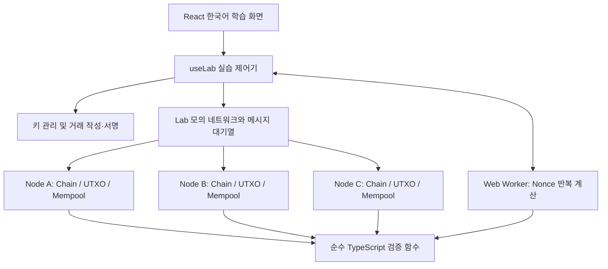

# 설계

## 책임 분리

Node.js/Vite는 정적 파일을 제공한다. 앱의 블록체인 상태는 브라우저 메모리에 있다. 네트워크 요청을 처리하는 백엔드나 DB는 없으며, 새로고침하면 새로운 실습이 시작된다.

## 주요 데이터와 직렬화

- Wallet: 이름·개인키·압축 공개키·주소. 잔액은 저장하지 않는다.
- UnsignedTransaction: `version=1`, `sessionId`, `inputs[{txId, outputIndex}]`, `outputs[{address, amount}]`, `publicKey`.
- Transaction: 위 필드에 64바이트 compact ECDSA `signature`와 `id` 추가.
- UTXO: `txId:outputIndex`를 키로 사용하고 주소·금액을 저장한다. 양의 안전한 정수만 사용한다.
- Block: 실습 ID·높이·이전 해시·거래 목록 해시·시각(ms)·난이도·Nonce·거래 목록·블록 해시. Genesis에만 초기 배정 `allocations`가 있다.
- NodeState: 각자의 체인 배열·UTXO 사전·Mempool 배열·처리한 페이로드 지문 집합·최근 검증 결과. 다른 노드의 자동 수신이 선택 노드의 실패 설명을 덮어쓰지 않는다.
- NetworkMessage: 순번·출발·도착·종류·복사된 페이로드. 처리 전 대기열, 처리 후 이벤트 기록으로 상태를 구분한다.
- ValidationResult: `valid`, `code`, 한국어 `message`, 단계별 `steps`.
- TransactionLesson: 제출 노드·작성 원문·서명 원본·검증한 사본·입력 UTXO 스냅샷·실제 검증 결과와 관찰 단계. UI의 거래 추적 정보이며 검증 권한이나 원장의 일부가 아니다.

서명 원문은 고정 순서 배열 `[version, sessionId, 입력 튜플 배열, 출력 튜플 배열, publicKey]`의 JSON이다. UTF-8 바이트를 SHA-256으로 한 번 해시한 후 ECDSA `prehash:false`로 서명한다. 별도의 두 번째 해시가 암묵적으로 적용되지 않도록 한다. 거래 ID는 `[서명 원문 문자열, signature]`를 직렬화한 SHA-256이다. 출력 순서와 입력 순서는 의미를 가지며 바꾸면 서명이 달라진다. `id` 자체는 자기 해시의 입력에 넣지 않는다.

주소는 `mini_` + 공개키 바이트의 SHA-256이다. Bitcoin 주소와 호환되지 않는다. 블록 해시는 `[sessionId,height,previousHash,transactionsHash,timestamp,difficulty,nonce]`의 JSON을 SHA-256으로 계산한다. 거래 목록 해시에는 거래 ID뿐 아니라 각 거래의 실제 필드와 서명도 포함한다. 객체 키 순서에 의존하지 않게 고정 배열로 정규화한다.

## Genesis와 거래 처리

1. 지갑 두 개를 만든다. 새 실습 ID를 생성하고 Alice에게 100을 배정한다.
2. Genesis는 실습의 신뢰 시작점으로 별도 보관한다. 세 노드는 동일한 내용의 독립 사본에서 시작한다.
3. 초기 UTXO의 참조는 Genesis 해시와 배정 출력 번호다. 일반 거래·coinbase가 아닌 교육용 특례다.
4. 송금 시 해당 지갑의 확정 UTXO를 outpoint 순서대로 고르고, 다른 대기 거래가 예약한 입력은 제외한다.
5. 모든 입력은 한 지갑의 소유여야 한다. 수신자 출력과 필요 시 거스름돈을 만들며, 입력·출력 합계는 같아야 한다.
6. 서명·검증 성공 후 Mempool에 추가한다. 이때 확정 UTXO는 바꾸지 않는다.

서명 검사는 공개키로 수행한다. 개인키는 Wallet 관리와 서명 함수만 사용하며 노드 상태·메시지·이벤트로 보내지 않는다. 개인키의 암호학적 생명주기 보장을 제공하는 실제 지갑 구현은 아니다.

## 블록 처리의 원자성

`validateBlock`은 형식→연결→시각→고정 난이도→실제 거래 목록 해시→헤더 해시→PoW→모든 거래를 검사한다. 거래마다 원래의 확정 UTXO와 블록 내 사용 입력 집합을 사용해 이중 지출을 막는다. 같은 블록의 미확정 출력을 다시 쓰는 거래는 지원하지 않는다.

모든 검증에 성공한 경우에만 UTXO 사본에 거래를 적용하고 체인·UTXO를 함께 반영한다. 블록 뒤쪽 거래가 실패해도 앞쪽 거래가 부분 반영되지 않는다. 이후 남은 Mempool을 새 UTXO로 재검증하여 확정·충돌 거래를 제거한다. 블록 거래가 Mempool에 없다는 이유로 거부하지 않는다.

`validateChain`은 신뢰 Genesis와의 일치부터 확인하고 UTXO를 처음부터 재구축하며 모든 후속 블록을 검사한다.

## 모의 네트워크

A/B/C는 상태를 공유하지 않는다. 송신 노드는 자기 검증을 통과한 거래·블록을 다른 두 노드에 전체 연결 방식으로 전송한다. 페이로드는 `structuredClone`으로 복사한다. 전달받은 데이터는 수신 노드가 검증한다. 처리한 전체 페이로드 지문을 기억하므로 동일 메시지는 중복 저장하지 않는다. 같은 ID를 주장하는 다른 내용은 별도로 검증된다.

자동 전달은 700ms마다 한 메시지, 수동 전달은 버튼 한 번에 한 메시지다. 새 실습은 수동으로 시작한다. 이는 인터넷 지연의 측정값이 아닌 관찰용 시간 간격이다. 이벤트는 최근 200개까지 보관하고 화면은 최근 20개를 표시한다. `lastDelivery`는 실제 처리한 메시지와 검증 결과의 사본을 보관한다. `network.ts`는 출발·도착으로 경로를 계산하며 큐 선택은 경로 미리보기만 바꾸고 FIFO 순서를 바꾸지 않는다.

한 번에 하나의 Worker 채굴 작업만 허용한다. 이전 블록 전달이 남았거나 노드들의 tip이 다르면 새 후보 생성을 거부한다. 노드 단절·동시 채굴·고아 블록·재구성을 구현하지 않으므로 최장/최대 작업량 체인 선택을 흉내 내지 않는다.

## Worker 프로토콜

입력: `start(jobId,candidate,step,mode)`, `pause`, `resume`, `step`, `stop`. mode는 `fast` 또는 `learning`이며 생략하면 fast다. 출력: `progress`, `paused`, `found`, `stopped`, `error`와 `jobId`, `attempts`, `elapsedMs`, `observationMs`, mode, 최근 실제 `samples`, 마지막 계산 블록.

한 번 계산은 Nonce 하나만 시도한다. 연속 계산은 최대 약 40ms 단위로 작업하고 약 30ms 뒤 다음 묶음을 실행하여 메시지를 처리할 기회를 만든다. 진행 해시는 표본이며 모든 시도는 횟수에 반영한다. `elapsedMs`는 계산 구간 합계라 일시정지·표시 대기 시간을 제외한다.

학습 실행은 약 250ms마다 Nonce 하나를 실제로 계산한다. 계산 사이 관찰용 타이머 대기는 `observationMs`에만 누적하고 일시정지 시간은 누적하지 않는다. 두 모드의 표본은 실제 계산 후 생성한 `{nonce,hash,passed}`이며 최근 12개로 제한한다. 첫 묶음의 found에도 표본 배열을 보내며, Nonce 0이 유효하면 바로 인정한다. 다른 작업을 시작할 때 이전 타이머를 지우고 작업 식별자도 확인한다.

난이도 d의 성공 조건은 `hash <= 00...0ff...f`이다. 256비트에서 목표값은 `2^(256-4d)-1`, 성공 확률은 `16^-d`, 기대 시도 횟수는 `16^d`이다. d=1~4로 제한한다. Nonce는 음이 아닌 안전한 정수이며 범위 초과 시 오류로 중지한다.

중지·초기화 시 Worker를 종료하고 활성 jobId를 비운다. 이전 jobId의 늦은 결과는 무시한다. 채굴자가 찾은 결과도 메인 스레드의 `receiveBlock`으로 다시 검증한다.

## UI 상태와 실패 처리

탭·관찰 노드 이동은 Lab와 거래 작성·서명·검증 상태를 유지한다. `useLab`가 작성 폼과 `TransactionLesson`을 보관하고 `learningFlow`는 현재 선택 거래를 기준으로 단계를 계산한다. 서명 전후, 검증 실패, 검증 결과 관찰, Mempool, 그 거래가 포함된 후보의 채굴, 실제 노드별 블록 포함 여부를 구분한다. 검증과 Mempool 등록은 즉시 처리하고 결과 관찰 단계는 UI에서만 구분한다. 새 송금 조건·새 작성·초기화는 이전 완료 표시를 끊는다. 다른 노드의 최근 검증이 선택 거래의 결과를 덮어쓰지 않는다.

입력 원본 스냅샷은 과거 금액을 설명하기 위한 자료다. 입력 예약·소비, 출력 대기·확정 표시는 관찰 노드의 현재 Mempool·UTXO·체인에 근거한다. 화면이 이를 원장에 직접 반영하지 않는다. 채굴·일시정지 중에는 관찰 노드를 잠가 작업 대상 혼동을 막는다. 초기화는 명시적 확인 후 실행한다.

변조 화면은 정상 체인의 사본을 사용하며, 거래 금액 또는 블록 시각을 바꾼다. 해시만 재계산해도 서명·PoW·후속 연결을 자동 수리하지 않는다. 전체 체인의 첫 실패와 개별 관계 검사를 함께 보여준다.
