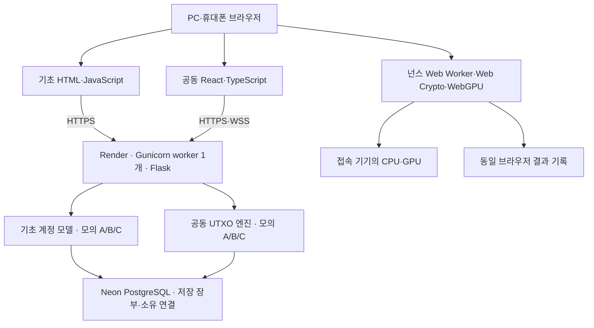

# 블록체인 실습실 최종보고서

**국문 과제명**: 비트코인 핵심 동작 원리 학습을 위한 웹 기반 교육용 블록체인 시스템 설계 및 구현

**영문 과제명**: Design and Implementation of a Web-Based Educational Blockchain System for Learning the Core Principles of Bitcoin

**소속**: 평택대학교 정보통신학과

**팀 구성**: 이준성(대표), 강지호, 안예원, 정수현 — 원팀 보고서의 명단 기준

**강지호의 수행 역할**: 기존 기초 실습 초안 이후 최종 서비스의 전반적인 고도화·개인 개발 결과물 통합·UI/UX 개선·기능 검증·무료 운영 배포·최종보고서 및 시연 영상 등 제출 자료 제작을 모두 담당하였다 개인 수행 내역은 3.3절에 명시하였다

**보고 기준일**: 2026-11-17

**개인 수행 내역 갱신일**: 2026-11-18

**서비스**: [블록체인 실습실](https://blockchain-practice.onrender.com)

**저장소 브랜치·실행 소스**: `blockchain-practice` · `experiments/blockchain-practice/`

| 구분 | 이 보고서의 기준 |
| --- | --- |
| 문서 작성의 기준 소스 | `63abc169a10ecc7e09554cf570f82bbd666d8cd1` |
| 마지막 배포·앱 검사 기록의 코드 | `9fca79179e4f93cfbde089dfb24d043aa9a8b952` |
| 버전 | 팀 앱 3.0.0 · 이식한 교육 엔진 3.2.0 |
| 문서 상태 | 최신 구현과 강지호의 개인 수행 내역을 반영한 제출 전 팀 확인본 — 그 밖의 개인별 담당·기간·기여 비율과 학교 양식·제출일은 부록에서 확인 |

문서 기준 커밋과 운영 앱의 기준을 구분한다 이 보고서 작성은 문서 작업이며 아래에 인용한 과거 앱 검사·녹화·배포를 새로 수행했다는 뜻이 아니다 원팀 HWP 보고서와 개인 본체는 별도로 보존한다

## 1. 과제 요약

본 과제는 지갑 생성, 거래 작성과 전자서명, 거래 검증, 작업증명, 블록 생성, 노드별 검증을 직접 조작하며 관찰할 수 있는 교육용 웹 시스템을 구현하는 것을 목표로 하였다 최종 결과물인 블록체인 실습실은 기초 실습, 공동 실습, 넌스 찾기의 세 화면으로 구성하였다

기초 실습은 계정 잔액과 거래 순번을 사용해 거래의 흐름을 익히도록 하였다 공동 실습은 UTXO, 수수료, 거스름돈, 입력 예약과 보상 성숙을 관찰하며 팀원이 같은 방에서 실습하도록 하였다 넌스 찾기는 메시지와 넌스로 실제 SHA-256을 계산하고 CPU·GPU 등 실행 방식에 따른 탐색 과정을 확인하도록 하였다 실제 자산이나 Bitcoin 네트워크에 연결하지 않는다

강지호는 기초 Python 코어와 Flask 화면에 사전에 개인적으로 개발한 교육 엔진·화면을 독립 사본으로 통합하고, 공동 참여 권한·상태 전달·서버 저장·재접속을 연결하였다 기존 기초 초안 이후의 고도화·통합·검증·배포·제출 자료 제작은 강지호가 수행하였다 기록된 운영 구성은 Render Free와 Neon Free PostgreSQL이며 저장에 성공한 기초·공동 장부는 앱 재시작 뒤 이어 읽는다

기존 실행 기록에는 Python 235개 검사 중 218개 통과와 17개 조건부 건너뜀, 팀 화면 단위 검사 147개 통과, 컨테이너·PostgreSQL 재시작 복원 성공이 남아 있다 실제 조작 영상은 기초 송금, 세 노드 채굴 비교, 공동 혼자 실습, 넌스 탐색의 관측값을 제시한다 이 결과는 구현한 기능과 제한된 실행 조건의 확인이며 학습자의 이해도 향상이나 대규모 운영 성능을 입증한 결과는 아니다 [검증 기록](test-results.md)

## 2. 문제 정의와 수행 목표

### 2.1 해결하려는 문제

해시·전자서명·채굴을 각각 설명하는 것만으로는 거래가 언제 유효해지고 장부에 언제 반영되는지 구분하기 어렵다 본 과제는 특히 거래 작성과 서명, 대기열 접수와 블록 포함, 블록 발견과 다른 노드의 수락을 분리해서 관찰할 수 있는 환경을 만드는 데 초점을 두었다

목표 사용자는 블록체인 입문자이며 수업·팀 활동에서 혼자 먼저 조작하거나 같은 링크를 공유해 참여하는 상황을 고려하였다 처음에는 기초 실습의 여섯 단계를 제공하고, 이후 공동 UTXO 실습과 독립 해시 탐색으로 학습 범위를 넓히도록 구성하였다 이러한 필요는 설계의 출발점이며 사용자 조사로 문제의 빈도나 심각도를 측정했다는 뜻은 아니다

### 2.2 목표와 확인 기준

| 목표 | 구현한 방법 | 확인할 상태와 근거 |
| --- | --- | --- |
| 거래의 단계를 구별 | 작성·서명·검증·제출·채굴을 별도 조작으로 제공 | 초안·서명·Mempool·블록 포함·잔액의 차이 |
| 변경 탐지의 역할을 구별 | 거래 내용 변경, 해시 재계산, 재채굴과 검증을 구분 | 서명·Merkle·PoW·연결 검사별 결과 |
| 노드별 판단을 관찰 | A/B/C의 체인·대기열과 전달 결과를 분리 | 선택 노드의 유효성, 끝 블록 해시, 수신·채택 여부 |
| 함께 실습하며 진행을 확인 | 이름·역할·공유 장부·다음 할 일·완료 판정 제공 | 선택 거래의 실제 접수·블록 포함·현재 체인 일치 |
| 서버 재시작 뒤 이어 사용 | 외부 DB 저장, 소유 연결·방 링크 복원 | 저장 장부와 링크의 복원, 역할 재선택 |
| 실제 해시 탐색을 관찰 | 넌스·해시·계산 수·실제 장치와 전환 이유 표시 | 정확 입력으로 해시를 독립 재검산 |

위 표는 기능과 관찰 가능성의 확인 기준이다 학습자가 각 개념을 설명할 수 있게 되었는지는 별도 학습 평가가 필요하다 상세 요구사항 ID와 코드 위치는 [요구사항](requirements.md)에 연결하였다

## 3. 개발 범위와 기존 구현의 활용

### 3.1 산출물별 역할과 기여

본 과제의 기여는 새 암호 알고리즘의 제안이 아니라, 학습 조작과 검증을 제공하는 코어를 웹 환경에 연결하고 공동 실습·저장·장치별 탐색을 일관된 학습 흐름으로 구성한 데 있다 기존 구현의 활용과 팀 앱에서 수행한 통합을 다음과 같이 구분한다

| 구성 | 기존 구현의 활용 | 최종 팀 앱에서 담당하는 역할·근거 |
| --- | --- | --- |
| 기초 Python 코어·Flask 화면 | 원팀 보고서가 설명한 지갑·거래·서명·Mempool·PoW·블록 검증을 바탕으로 정비 | 계정 모델의 기초 여섯 단계, 한 노드 채굴과 A/B/C 비교 — [기초 코어](../experiments/blockchain-practice/node.py) |
| 공동 교육 엔진 | 강지호가 사전에 개발한 개인 프로젝트의 UTXO·노드·채굴·서비스 코드를 독립 복사 | 수수료·예약·거스름돈·분기·재구성·보상 성숙 — [교육 엔진 안내](../experiments/blockchain-practice/education_engine/README.md) |
| 공동·넌스 화면 | 강지호의 개인 프로젝트 화면과 해시캐시 실습을 활용한 독립 사본 | 공동 입장·역할·쉬운 실습·완료 가이드, CPU/GPU·선택형 PC 엔진 — [팀 화면 소스](../experiments/blockchain-practice/frontend/src/) |
| Flask 통합·운영 | 복사한 엔진의 전송 계층과 저장 경로 등을 팀 실행 환경에 맞게 조정 | Flask API·WebSocket, 교사 없는 참여, PostgreSQL·재연결·동일 링크 복원 — [설계](architecture.md) |
| 안내·제출 자료 | 팀 피드백과 최신 구현을 반영 | 기초 중심 메뉴, 여섯 단계 설명, 공통 테마, 실제 조작 영상·대본 |

이식한 교육 엔진의 출처는 강지호의 개인 v3.2.0, `42024d71c603dfd1b98b538158e7978b7d820e73` 작업 트리이다 당시 미커밋 변경이 있던 `service/classroom.py`·`session.py`·`storage.py`도 포함되어 단일 커밋만으로 복사본을 완전히 재구성한다고 주장하지 않는다 [PROVENANCE.json](../experiments/blockchain-practice/education_engine/PROVENANCE.json)은 이식 당시 엔진 파일의 원본·이식 해시와 조정 내역을 기록한다 이 파일이 화면·기초 코어를 포함한 앱 전체의 출처나 개인별 기여율까지 증명하는 것은 아니다

개인 소스·DB·실행 서버는 팀 앱의 런타임에서 참조하지 않는다 강지호가 수행한 업무는 3.3절에 명시하며 그 밖의 개인별 담당·세부 기간·기여 비율은 실제 팀 기록으로 별도 확정한다 산출물의 기술적 출처와 개인별 기여 비율은 구분한다

### 3.2 원팀 보고서 기재 범위와 현재 확장

| 원팀 보고서가 주로 다룬 범위 | 최신 앱에 추가·연결한 내용 | 현재 확인 범위 |
| --- | --- | --- |
| 계정 모델의 지갑·거래·서명·채굴·체인 검증 | 기초 여섯 단계와 상태 안내, 한 노드·세 노드 채굴 비교 | 구현·회귀 정의·정상 시연 |
| 기초 노드·웹 조작 설명 | UTXO 공동 장부, 별명·역할·혼자 진행, 실제 상태 기반 가이드 | 구현·관련 검사 기록·혼자 실습 시연 |
| 기초 채굴의 Nonce 설명 | 별도 넌스 찾기, CPU/GPU·CPU+GPU와 선택적 Python/C | 구현·장치별 검사 범위, 영상은 CPU 사례 |
| Render 웹 배포 설명 | 외부 PostgreSQL과 소유·방 링크 복원, 자동 연결 안내 | 재시작 CI·배포 전후 대조 기록 |

이는 문서에 기재된 범위와 최신 산출물의 비교이다 원보고서의 정확한 작성 커밋은 식별되지 않았으므로 기재되지 않은 기능이 당시 코드에도 반드시 없었다고 단정하지 않는다 학습 완주율·오류 감소·속도의 개선 전후 측정은 수행하지 않았다

### 3.3 강지호의 개인 수행 내역

**아래에 기재한 여섯 범위는 모두 강지호가 담당하여 수행한 업무이다 기존 기초 실습 초안을 바탕으로 최종 온라인 서비스로 발전시키는 고도화·통합·검증·배포·제출 자료 제작을 수행하였다**

| 담당 범위 | 강지호가 수행한 내용 |
| --- | --- |
| 개인 개발 결과물 제공·통합 | 사전에 개인적으로 개발한 블록체인 교육 엔진과 React 화면을 팀 Flask 앱에 독립 사본으로 통합하고 UTXO·전자서명·수수료·거스름돈·보상 성숙 기능을 연결하였다 |
| 기초 실습·UI/UX 고도화 | 기존 초안의 화면·설명·조작 흐름을 보완하고 기초 6단계 안내를 구성하였다 복잡한 통합 화면은 공개 메뉴에서 제외하고 필요한 기능을 기초 실습으로 선별·이식하며 테마·용어·상태 안내를 정리하였다 |
| 공동 실습·채굴·넌스 기능 확장 | 별명·역할·혼자 진행·실제 상태 기반 완료 가이드를 구성하였다 한 노드·세 모의 노드 채굴 비교, CPU·GPU·CPU+GPU 넌스 탐색과 CPU 전환, 선택형 로컬 Python·C 연산을 연결하였다 |
| 무료 서버 배포·기록 보존 | Render·Neon PostgreSQL 운영 환경을 구축하였다 서버 재시작 후 저장 장부·공동 링크 보존을 연결하고 서버 준비 안내와 자동 재연결을 개선하였다 |
| 검증·기술 설명 정리 | 코드·검사 기록·실제 조작 결과를 대조해 거래·서명·채굴·저장·복원 동작과 설명 오류를 점검하고 구현 범위·검증 한계를 정리하였다 |
| 최종 제출 자료 제작 | 최신 구현을 반영한 최종보고서·사용 안내·기술 문서를 작성·정리하였다 실제 마우스 조작과 한국어 설명 음성과 자막을 담은 4분 33초 시연 영상을 제작해 앱에 반영하고 GitHub 소스·문서를 관리하였다 |

이 수행 범위는 [README의 개인 수행 내역](../README.md#강지호의-개인-수행-내역)과 동일하다 강지호의 사전 개발 결과물 제공과 기존 기초 초안 이후의 고도화·통합·서비스 구축·제출 자료 제작을 연결해 명시하였다 검증의 실제 조건과 한계는 8~11절의 기록을 따른다

## 4. 시스템 설계

### 4.1 실행·통신·저장 구조



그림 1. 최신 팀 앱의 논리적 구성 — 기준 소스 `63abc16`, 운영 기록의 앱 `9fca791`, [app.py](../experiments/blockchain-practice/app.py)·[education_api.py](../experiments/blockchain-practice/education_api.py)·[team_rooms.py](../experiments/blockchain-practice/team_rooms.py)를 바탕으로 작성한 요약도

Flask 하나가 기초 화면과 빌드한 React 화면·API를 제공한다 Node.js는 화면 빌드에 사용하고 별도 FastAPI 서버는 실행하지 않는다 실제 인터넷 통신은 브라우저와 Flask 사이에서 발생한다 A/B/C는 한 서버 안의 독립 상태이며 브라우저 세 대가 독립 Bitcoin 노드가 되는 구조는 아니다

활성 방과 실행 스케줄러를 메모리에 관리하므로 Gunicorn worker는 하나로 운영한다 로컬은 분리된 SQLite 저장소를 사용하고, 기록된 운영 구성은 외부 Neon PostgreSQL을 사용한다 임시 앱 컨테이너의 파일 보존에만 의존하지 않는다 [실행·저장 설계](architecture.md)

### 4.2 세 실습의 모델 경계

| 항목 | 기초 실습 | 공동 실습 | 넌스 찾기 |
| --- | --- | --- | --- |
| 학습 중심 | 거래·서명·채굴·변조·노드 | UTXO·수수료·팀 역할·전파 | 메시지와 넌스의 해시 탐색 |
| 장부 | 계정 잔액·거래 순번 | 노드별 UTXO·체인·Mempool | 장부를 변경하지 않음 |
| 초기 코인 | 새 주소당 50 지급 거래를 한 번 접수 | Genesis에서 A/B/C 각 100 기본 배정, 새 방은 각 1~10000 선택 | 코인 배정 없음 |
| 채굴 보상 | 별도 선택 보상 지갑에 10 | 별도 보상 지갑에 50+수수료, 100블록 성숙 | 보상·발행 없음 |
| 계산·저장 | 서버 계산·서버 장부 저장 | 서버 계산·서버 장부 저장 | 브라우저 계산·동일 브라우저 최근 50개 저장 |

기초 지급 거래는 블록에 포함된 후 확정 잔액에 반영된다 다만 기초 접수 검사는 대기 거래를 순서대로 반영한 임시 상태도 사용하므로, 미확정 지급을 바탕으로 후속 송금이 접수될 수 있다 안내에서는 지급을 먼저 채굴해 확정한 뒤 송금하는 순서를 사용한다 이는 **권장 학습 순서**이며 구현이 미확정 잔액의 사용을 항상 금지한다는 뜻은 아니다 [Mempool 구현](../experiments/blockchain-practice/mempool.py)·[기초 규칙 검사](../experiments/blockchain-practice/tests/test_core.py)

세 모델의 지급·보상·잔액을 합치지 않으며 기초 계정 모델을 실제 Bitcoin의 UTXO 장부와 동일하게 설명하지 않는다

## 5. 핵심 동작의 구현

### 5.1 지갑·전자서명·일반 송금 검증

기초 지갑은 secp256k1 키 쌍을 만들고 공개키 바이트의 SHA-256을 교육용 주소로 사용한다 거래는 종류·송신 공개키·수신 주소·금액·거래 순번·시각을 서명 대상에 포함한다 서명 검사는 해당 공개키와 대응하는 개인키로 승인했는지, 서명한 내용이 변경되지 않았는지를 확인한다 이용자의 실명 인증이나 거래 내용의 암호화 기능은 아니다 [지갑 구현](../experiments/blockchain-practice/wallet.py)·[거래 구현](../experiments/blockchain-practice/transaction.py)·[SEC 1 4.1절](https://www.secg.org/sec1-v2.pdf)

일반 송금은 기본 형식·서명·잔액·거래 순번 검사를 통과해야 Mempool에 등록된다 기초 Faucet은 주소당 지급 규칙을 검사하는 시스템 거래이고 Coinbase는 채굴 후보에서 별도로 생성한다 따라서 모든 종류의 거래에 일반 송금과 같은 사용자 서명을 요구한다고 설명하지 않는다

대기 중인 같은 거래의 재접수는 거래 ID 중복으로, 이미 반영된 송금의 재접수는 현재 상태와 맞지 않는 순번 등으로 거부한다 재구성으로 블록에서 제외된 거래는 새 장부에 대해 다시 검증한다 거래 순번과 채굴 Nonce는 목적이 다르며 공동 UTXO 모델에 기초 순번 규칙을 그대로 적용하지 않는다 [Mempool](../experiments/blockchain-practice/mempool.py)·[노드](../experiments/blockchain-practice/node.py)

### 5.2 해시·Merkle·작업증명과 변조 실험

SHA-256은 입력으로부터 256비트 요약값을 계산한다 변경 탐지는 신뢰할 기준값과의 비교가 전제이며 입력 후보가 적으면 후보를 해시해 비교할 수 있으므로 해시 자체가 비밀성을 보장하지 않는다 [FIPS 180-4](https://csrc.nist.gov/pubs/fips/180-4/upd1/final)

기초 블록은 거래 ID를 묶은 Merkle root를 헤더에 포함하고, 홀수 개일 때 마지막 값을 복사해 쌍을 만든다 교육 엔진은 거래 필드 목록의 정규화 해시를 사용하므로 이 부분을 기초의 Merkle tree와 혼동하지 않는다 두 모델의 교육용 헤더·단일 SHA-256은 Bitcoin의 바이너리 헤더·이중 SHA-256과 호환되지 않는다 [기초 블록](../experiments/blockchain-practice/block.py)·[모델 비교](bitcoin-differences.md)

채굴은 Nonce를 바꾸며 실제 해시를 계산한다 이 앱의 선행 16진수 0 개수 `d`에 대한 이상화된 성공 확률은 한 시도당 `16^-d`이고 기대 시도 수는 `16^d`이다 난이도 한 단계 증가 시 기대 계산량이 16배가 되지만 한 번의 성공 시간이나 시도 수를 보장하지 않는다 유효 PoW는 정확히 몇 번 계산했는지나 금전적 가치를 증명하지 않는다 [Bitcoin 백서 4절](https://bitcoin.org/bitcoin.pdf)·[교육용 난이도 정의](bitcoin-differences.md)

변조 실험은 내용만 변경하기, Merkle·블록 해시 재계산, 후속 블록 재채굴을 구분한다 해시를 다시 계산하거나 PoW를 만족해도 잘못된 서명까지 유효해지는 것은 아니다 검증은 Genesis·해시·Merkle·PoW·이전 연결·거래 규칙을 확인한다 [체인 검증 구현](../experiments/blockchain-practice/blockchain.py)

### 5.3 한 노드 채굴·세 노드 비교·체인 채택

기초 실습은 한 노드 채굴을 기본으로 제공하고 단계 실행·연속 실행·일시정지·재개·중지를 지원한다 세 노드 비교는 온라인이며 유효한 같은 끝 블록을 가진 A/B/C가 각각 후보를 만들고 순서를 번갈아 실제 해시를 계산한다 첫 발견 후 나머지 후보의 계산을 중지하고 발견 블록을 전달한다 노드별 계산 수·Nonce·해시·발견 결과를 표시한다 [비교 회귀 정의](../experiments/blockchain-practice/tests/test_basic_mining_comparison.py)

채굴 노드는 유효 블록을 자기 체인에 먼저 반영한다 전달받은 다른 노드는 독립 검증과 자신의 체인 채택 조건을 충족하면 반영한다 채굴 성공과 모든 노드의 같은 블록 수락은 별도 상태다 동기화는 유효성과 누적 작업량을 비교하며 동률이면 현재 유효 체인을 유지한다 Genesis는 체인의 첫 블록이고 이 앱은 고정된 교육용 Genesis를 사용한다 [노드·동기화 구현](../experiments/blockchain-practice/node.py)

이 비교는 같은 서버 스케줄러의 교육용 계산이다 세 PC나 세 GPU의 병렬 성능·실제 P2P 합의의 안전성을 측정한 결과로 사용하지 않는다

## 6. 공동 실습과 학습 안내

### 6.1 참여·UTXO·초기 배정

팀원은 같은 방 링크에서 별명을 입력하고 비어 있는 A/B/C 역할을 선택한다 교사나 최초 생성자가 계속 접속해 있을 필요는 없다 혼자 A를 맡아도 서버의 B/C 노드는 거래와 블록을 검증한다 서명은 자기 팀의 권한을 확인하고 채굴·전파 등 공통 조작과 구분한다

기본 방은 A/B/C에 각각 100코인을 한 번 배정한다 명시적으로 새 실습을 만들 때만 각 팀에 같은 초기 금액을 1~10000 중 선택한다 기존 링크 입장·추가 참가·재접속으로 코인을 재발행하지 않는다 [공동 방 구현](../experiments/blockchain-practice/team_rooms.py)·[새 방 검사](../experiments/blockchain-practice/tests/test_team_practice_setup.py)

공동 송금은 미사용 출력인 UTXO를 입력으로 선택하고 수신·거스름돈·수수료를 계산한다 초기 100 UTXO에서 송금 10·수수료 1을 접수하면 입력 100 전체가 예약되어 잔액이 있어도 사용 가능액이 0으로 보일 수 있다 블록 반영 후 수신 10과 거스름돈 89로 나뉘며 `100 = 10 + 89 + 1`을 만족한다

새 채굴 보상 50과 수수료는 별도 보상 지갑에 기록하고 100블록 성숙 조건을 적용한다 송금 예시의 팀 지갑 합계를 비교할 때는 보상 지갑을 포함한 총발행과 구분한다 [UTXO·보상 규칙](architecture.md)·[Bitcoin 거래 개념](https://developer.bitcoin.org/devguide/transactions.html)

### 6.2 기초 실습의 여섯 단계

| 단계·화면 | 학습할 구분 | 실제 조작 | 확인할 상태 |
| --- | --- | --- | --- |
| 1 · 지갑 만들기 | 키·주소와 잔액의 차이 | Alice·Bob 두 지갑 생성 | 서로 다른 주소, 각 지급 대기 거래 |
| 2 · 초기 코인 확정 | 지급 대기와 확정 잔액 | 한 노드에서 지급 거래 채굴 | 각 50 확정, 보상은 별도 지갑 |
| 3 · 거래 작성·서명·제출 | 작성·승인·접수의 차이 | 송금 20을 작성→서명→제출 | 서명 상태·Mempool, 아직 블록 미포함 |
| 4 · 송금 확정 | 접수와 블록 포함의 차이 | 한 노드 또는 세 노드 비교로 채굴 | 블록 포함·잔액, 타 노드 반영은 별도 확인 |
| 5 · 변조와 검증 | 내용 변경·해시·PoW·서명의 차이 | 서명된 송금 변경 후 검증 | 실패한 검사·위치·이유 |
| 6 · 노드 비교·동기화 | 자기 장부와 다른 노드 판단의 차이 | 끝 블록·유효성 비교, 필요 시 동기화 | 유효 체인 채택과 끝 해시 일치 |

표 1. 실제 시작 화면의 여섯 단계를 학습 목표·조작·관찰 상태로 연결 — [화면 정의](../experiments/blockchain-practice/static/index.html) 기준, 학습자의 이해도 측정표는 아님

공동 실습의 쉬운 진행과 완료 가이드는 선택 거래의 접수·블록 포함·현재 체인 일치를 읽는다 안내 화면 이동 자체를 완료로 처리하지 않으며 재구성 등으로 현재 결과가 바뀌면 판정도 갱신한다 화면의 완료 6/6은 구현된 조건의 충족이고 사용자의 개념 이해도 점수가 아니다 [가이드 판정](../experiments/blockchain-practice/frontend/src/ui/teamGuideProgress.ts)

## 7. 넌스 찾기와 선택형 연산

넌스 찾기는 다음 교육용 규칙을 사용하며 블록·잔액을 변경하지 않는다

```text
hash = SHA256(UTF8(원본 메시지 + 넌스의 10진수 문자열))
성공 조건 = 앞의 16진수 0이 설정 개수 이상
```

메시지의 공백·줄바꿈을 유지하고 넌스는 uint64 범위를 확인한다 Hashcash와 같은 해시 기반 작업증명 개념을 탐색하는 기능이며 원본 스탬프 형식이나 Bitcoin 채굴 형식과의 호환을 주장하지 않는다 [계산 규칙](../experiments/blockchain-practice/frontend/src/hashcash/core.ts)

브라우저 CPU는 Web Crypto와 Worker를 사용하고 GPU는 WebGPU 셰이더를 사용한다 CPU+GPU는 겹치지 않는 구간을 나누어 계산한다 GPU 미지원·검증 실패·계산 오류 또는 메시지 UTF-8 35바이트 초과 시 CPU로 전환하고 실제 장치·이유·완료 계산 수를 표시한다 HTTPS 또는 localhost와 기본 Web Crypto·Worker 지원이 필요하며 그 기능도 없는 브라우저에는 지원 안내를 표시한다 [실행기](../experiments/blockchain-practice/frontend/src/hashcash/runner.ts)

GPU는 배치 계산이므로 발견 넌스와 완료 계산 수가 다를 수 있고 최소 넌스를 먼저 찾거나 항상 더 빠르다고 보장하지 않는다 발견 결과는 별도 SHA-256으로 다시 확인한다 브라우저 저장이 허용될 때 최근 50개를 같은 브라우저에 남기며 저장 실패·데이터 삭제·다른 기기에서는 같은 보존을 보장하지 않는다

Python·C는 준비된 로컬 PC에서만 명시적으로 켜는 선택 기능이다 Python CUDA에는 호환 NVIDIA 드라이버·CuPy, C에는 GCC·OpenSSL 등의 별도 조건이 필요하다 공개 Render에서는 Native를 비활성화한다 사전 사용 가능 확인 실패와 작업 요청 후 응답 유실을 구분하며 이미 계산이 시작되었을 수 있는 요청을 다른 엔진에서 자동 중복 실행하지 않는다 과거 로컬 Python/C CPU 확인과 실제 CUDA 실기기 검증은 별개다 [PC 엔진 안내](../experiments/blockchain-practice/native_hashcash/README.md)

## 8. 검증 방법과 증거 구분

### 8.1 환경과 판정 단위

기록된 앱 검사 환경은 Windows·Python 3.13.15·Node.js 24.19.0·npm 11.17.0이며 운영 컨테이너 검사는 Linux Docker·Gunicorn·별도 PostgreSQL을 사용하였다 코드 기준은 `9fca791`이다 [환경·실행 기록](test-results.md)

검증은 ① 코어 규칙·API의 회귀 검사 ② 화면 타입·단위 검사·빌드 ③ 제한된 브라우저 조작과 시연 ④ 컨테이너 교체·저장 복원으로 나눈다 코드에 정의된 검사, 과거 실행에서 통과한 기록, 영상의 특정 관측, 이번 문서 확인을 같은 결과로 합산하지 않는다

정상 동작에서는 잔액·거래·블록 상태를 대조하고 실패 대조에서는 일반 송금의 미서명·서명 후 변경·잔액 부족을 사용한다 운영 기록이 있는 DB는 실험을 위해 초기화하지 않으며 자동 검사와 시연은 분리된 실습·테스트 저장소를 사용하는 원칙을 적용한다

### 8.2 정상·거부 사례의 검사 설계

| 사례 | 입력·조건 | 기대 판정 | 확보 근거와 범위 |
| --- | --- | --- | --- |
| 정상 송금 대조 | 일반 송금 10을 작성하고 송신 키로 서명 | 기본 검사 통과 | `WalletTx.test_signature_detects_any_field_change`의 정상 기준 |
| 미서명 일반 송금 | 같은 거래를 서명 전 검사 | 거부 | 같은 함수의 `basic_check` 실패 확인 정의 |
| 서명 후 변경 | 정상 서명 후 금액을 1000 등으로 변경 | 이전 서명 검증 실패 | 같은 함수의 금액·주소·순번·시각 변경 검사 |
| 잔액 부족 | 50 지급을 접수한 대기 상태에서 9999 송금 | 잔액 부족 거부 | `Rules.test_balance_and_amount_rules` |
| 재전송 | 동일 지급·일반 거래 재접수 | 중복 또는 현재 순번 규칙으로 거부 | `Rules.test_faucet_once_and_replay` |
| 변조 뒤 재채굴 | 서명 거래를 바꾼 뒤 후속 PoW 재수행 | 잘못된 서명이 유효해지지 않음 | `Tamper.test_remine_all_still_fails_on_signature` |

표 2. [test_core.py](../experiments/blockchain-practice/tests/test_core.py)에 정의된 정상 대조와 거부 사례 — `9fca791`의 기존 Python 스위트 실행 기록과 연결하며 이번에 새로 실행한 수동 관측은 아님

원팀 보고서의 수동 거부 실험은 개별 입력·실행 날짜·오류 화면을 확보하지 못했으므로 표 2에서는 확인 가능한 회귀 검사와 기존 실행 기록의 범위를 제시하였다

### 8.3 기존 검사 기록

| 대상 | 기록된 결과 | 해석 범위 |
| --- | --- | --- |
| Python `unittest discover -s tests` | 총 235개 중 218개 통과·17개 조건부 건너뜀, 실패 없음 | 로컬 PostgreSQL 조건 등이 필요한 건너뜀을 포함 |
| 팀 화면 `npm run check` | 147개 단위 검사·타입·ESLint·빌드 통과 | 학습 효과·전체 E2E 통과를 뜻하지 않음 |
| 루트 `npm run lint` | 통과 | 해당 코드 경로의 정적 검사 |
| 브라우저 `--list` | 34개 사례 목록 수집 | 이 실행은 34개 E2E 통과가 아님 |
| `production-restart` | 성공 | 운영 이미지·제한 자원·정상 종료·교체 뒤 복원 |
| `postgres-restart` | 성공 | 별도 PostgreSQL·앱 교체 후 장부·접근 연결 복원 |

두 컨테이너 작업의 기존 성공 상태는 [GitHub Actions 43961448887](https://github.com/jiho6367-design/mini-bitcoin-education/actions/runs/43961448887)에서 읽기 전용으로 재확인하였다 로컬의 조건부 건너뜀과 별도 PostgreSQL 통합 CI는 서로 다른 실행으로 집계한다

검사별 상세 이력은 [VERIFICATION.md](../experiments/blockchain-practice/VERIFICATION.md)에 보존하였다 실제 휴대폰·카카오톡 내부 브라우저의 모든 기종, 실제 Python/C CUDA 성능, 대규모 수업과 장기 운영은 위 결과의 범위 밖이다

## 9. 실제 조작 시연에서의 관찰

### 9.1 조건과 결과

2026-11-17 시연은 기존 팀 장부와 분리된 실습을 사용하였다 보상 지갑을 별도로 둔 조건에서 다음 값을 관찰하였다

| 시연 항목 | 입력·조작 조건 | 관찰 결과 | 영상 위치 |
| --- | --- | --- | --- |
| 기초 지급·송금 | Alice·Bob 각 50 확정, Alice→Bob 20, 난이도 2 | Alice 30·Bob 70 | 약 0:21~2:16 |
| 기초 세 노드 비교 | 같은 끝 블록, A/B/C 순환 계산 | 해당 실행의 첫 발견 B, 시도 수 A13/B13/C12 | 약 1:24~2:01 |
| 공동 혼자 실습 | 새 방 각 100, A 역할, A→B 10·수수료 1, A 단일 채굴 | A89·B110·C100, 가이드 6/6 | 약 2:16~3:35 |
| 공동 새로고침 | 저장 후 같은 링크·브라우저로 재접속 | 같은 방과 장부 확인 | 공동 실습 구간 |
| 넌스 CPU | 아래 정확 메시지, 난이도 3, 시작 0 | 3055 발견·3056회 계산, 재검증 일치 | 약 3:35~4:33 |
| 넌스 기록 | 같은 브라우저 새로고침 | 찾은 기록 유지 | 넌스 구간 |

기초 잔액은 `50−20=30`, `50+20=70`과 일치한다 공동 송금 지갑은 `100−10−1=89`, `100+10=110`이며 C는 100을 유지한다 별도 지갑에 기록된 보상·수수료를 위 팀 지갑 잔액과 혼합하지 않는다

기초 세 노드의 발견 순서·시도 수는 특정 후보와 실행의 값이다 같은 메시지의 순차 넌스 탐색 재현과 달리 다음 채굴에서도 B가 같은 횟수에 이긴다고 보장하지 않는다 CPU/GPU 성능 비교나 학습 효과의 통계 결과로 사용하지 않는다

### 9.2 넌스 결과의 정확한 재현 조건

```text
메시지: You are the best of best!!!!
느낌표: 4개
앞뒤 공백·줄바꿈: 없음
결합: UTF-8 메시지 뒤에 구분자 없이 넌스의 10진수 문자열
방식: CPU 순차 탐색, 시작 0
난이도: 선행 16진수 0 세 개
첫 충족 넌스: 3055
계산 횟수: 3056회 (0~3055 포함)
SHA-256: 0002a0cc7ab05331087b7525cea18a492af097a20f4c350f5b83bd7ce05f8010
```

녹화의 발견 기록과 별도 오프라인 `hashlib` 계산이 일치하였다 아래 코드는 동일 조건을 앱·서버·DB 없이 확인하는 예시이며 이전 검토와 이번 문서 확인에서 실행해 결과를 대조하였다

```python
import hashlib

message = "You are the best of best!!!!"
for nonce in range(3056):
    digest = hashlib.sha256((message + str(nonce)).encode("utf-8")).hexdigest()
    if digest.startswith("000"):
        print(nonce, nonce + 1, digest)
        break
```

정확 메시지·결합 규칙·시작점이 같을 때의 결정적 결과이며 메시지의 공백 하나만 달라도 다른 탐색이 된다

### 9.3 화면과 제출 영상


그림 2. 2026-11-17 운영 기록의 실제 시작 화면 — 앱 코드 `9fca791`, 기초 여섯 단계와 접힌 시연 영상 영역 현재 화면을 설명하는 자료이며 옛 개인 React 캡처와 구분

[최신 실제 조작 영상](../experiments/blockchain-practice/static/media/blockchain-practice-demo-narrated.mp4)은 273.033초(4분 33초), 2880×1980, 30fps이다 앱 화면 2880×1800 아래에 자막 공간을 두고 실제 클릭·화면 변화를 연속 녹화하였다 정지 대기 구간을 정리하고 한국어 설명 음성을 추가하였다 [시연 대본](demo-script.md)

```text
영상 SHA-256:
F9A1960F96FECC87D204A56DE65969195CB679F71176D91D07B2CC1D05B69442
```

## 10. 저장·재연결·운영 결과

### 10.1 기록과 접근 정보의 보존

온라인 기초·공동 장부는 PostgreSQL에 저장하고 로컬 기본 실행은 분리된 SQLite를 사용한다 저장에 성공한 장부·방 링크·소유 연결을 앱 재시작 후 이어 읽는다 배포 전후 대조 기록은 기초 실습 10개, 보관 기록 36개, 이벤트 1803개, 소유 연결 30개, 공동 링크 6개, 참가자 12명의 당시 행과 내용이 유지되었다고 보고한다 이 숫자는 과거 대조의 스냅샷이며 현재 사용자 수나 최대 처리량이 아니다 [운영 대조 기록](test-results.md)

장부 복원과 실행 중 작업의 재개는 다르다 기초 실습은 서버 재시작 시 미완료 채굴 후보·비교를 취소하므로 새 후보로 다시 시작한다 공동 실습은 계산을 일시정지 상태로 복원하고 임시 권한을 새로 발급한다 역할을 다시 선택하고 자동 전달·계산을 다시 활성화한다 개인 실습 접근은 브라우저 소유 쿠키에 의존하므로 다른 기기·쿠키 삭제 뒤 자동 복구하는 계정 로그인 기능은 없다 공동 방은 기존 링크로 다시 참여할 수 있다 [기초 복원 구현](../experiments/blockchain-practice/node.py)·[공동 복원 구현](../experiments/blockchain-practice/team_rooms.py)

같은 DB를 앱 교체 뒤 이어 읽는 검사와 DB 자체의 손상·삭제 후 백업에서 복원하는 훈련은 구분한다 저장 실패·손상 데이터의 무조건 복원이나 운영자 PostgreSQL 백업 복구 완료를 주장하지 않는다

### 10.2 서버 준비와 불확실한 변경 요청

일시적인 서버 준비·연결 장애에는 준비 상태를 안내하고 읽기 요청으로 다시 연결한다 송금·채굴·저장 같은 변경 요청을 자동으로 반복하지 않는다 기초 화면은 현재 상태를 먼저 조회하며 공동 화면의 처리 여부가 불확실하면 같은 요청 확인 절차를 사용한다 권한·주소 오류는 정상 준비 대기와 구분한다

### 10.3 무료 운영의 조건

기록된 구성은 Render Free 앱과 Neon Free PostgreSQL이며 유료 영속 디스크를 사용하지 않는다 이는 기준일 배포 구성이고 향후 무료 정책·무중단·무제한 사용을 보장하는 약속은 아니다 서버 준비·자원·대역폭·재배포 중 단절의 제한이 있으며 최신 계약·한도는 운영자가 확인해야 한다

현재 코드는 기본 방과 추가 방 최대 3개, 방당 참가 상한 30명을 둔다 이는 활성 방 관리의 코드 상한이며 120명 동시 실습 성능을 입증한 숫자가 아니다 접속자가 없는 추가 방은 저장·일시정지 후 메모리에서 비울 수 있고 같은 링크로 복원한다 단일 worker를 여러 서버로 단순 복제하는 확장은 현재 범위 밖이다 [배포·운영 안내](../experiments/blockchain-practice/DEPLOYMENT.md)

현재 주소와 기존 소유·저장 식별자를 유지한다 옛 주소의 연결 전용 서비스는 장부를 따로 복제하거나 두 서버가 동시에 쓰는 구조가 아니다 실제 DB 접속 문자열·교사 코드·소유 쿠키·키·개별 저장 자료는 이 보고서에 포함하지 않는다

## 11. 결과의 해석과 한계

기존 기초 코어에 공동 UTXO·영속 저장·넌스 계산을 연결하고 기초 중심의 공개 메뉴와 진행 안내를 제공하였다 기능 수 증가 자체를 학습 성과로 보지는 않으며 현재 확인한 것은 조작·관찰 가능한 구현과 해당 조건의 실행 결과다

| 아직 입증하지 않은 부분 | 현재 근거로 주장할 수 없는 내용 | 후속 평가 방법 |
| --- | --- | --- |
| 학습 효과·초보자 사용성 | 안내 추가가 이해도·완주율을 향상시켰다는 결론 | 같은 과제의 완주·막힌 지점·개념 설명을 기록하고 비교 |
| 연산 성능 | GPU·CPU+GPU가 항상 빠르다는 결론 | 같은 기기·입력·탐색 범위, 준비 비용과 계산 시간을 분리해 반복 비교 |
| 실제 분산 보안 | 한 서버 A/B/C로 Bitcoin 합의·경제적 보안을 입증 | 현재 모델의 단순화를 명시하고 별도 P2P 환경에서 검증 |
| 운영 규모·재해 복구 | 코드 상한만큼 동시 수업 보장, DB 손상도 자동 복구 | 별도 부하·장기 운영·백업 복원 훈련 |
| 기기·접근성 | 390px 배치 확인으로 모든 휴대폰·내부 브라우저·접근성 인증 완료 | 실제 기기·키보드·보조 기술의 과제 수행 평가 |

이 표의 후속 평가는 계획이며 수행 결과가 아니다 실제 Bitcoin의 주소·거래·직렬화·Script·전체 발행 정책을 구현하지 않았고 서버가 교육용 키를 보관하므로 실제 자산 지갑으로 사용할 수 없다 상세 차이는 [Bitcoin과의 차이](bitcoin-differences.md)에 명시하였다

## 12. 결론

본 과제는 지갑에서 거래·서명·검증·채굴·노드 반영으로 이어지는 흐름을 직접 조작할 수 있는 블록체인 실습실을 구현하였다 기초 계정 모델과 공동 UTXO 모델, 독립 넌스 탐색을 구분하고 기존 구현의 독립 이식과 Flask 통합·저장·참여 제어를 통해 온라인 팀 실습 환경을 구성하였다

기존 회귀·복원 기록과 실제 조작 영상으로 정상 송금·채굴·공동 실습·정확 입력의 넌스 결과를 확인하였다 현재 성과는 학습자가 원리를 조작하고 관찰할 기능과 실행 환경의 제공이며 실제 이해도 향상·장기 운영·대규모 수업 성능은 후속 평가가 필요하다

## 참고문헌과 구현 근거

외부 자료는 개념·알고리즘의 근거이고 앱 구현·시연·교육 효과의 증거를 대신하지 않는다 아래 자료의 해당 항목과 프로젝트 소스·기록을 구분해 사용하였다

1. S. Nakamoto, *Bitcoin: A Peer-to-Peer Electronic Cash System*, 2008 — 2절 거래·서명, 4절 PoW, 5절 전달·검증, 7절 Merkle 개념 [원문](https://bitcoin.org/bitcoin.pdf)
2. NIST, *Secure Hash Standard (SHS)*, FIPS 180-4, Aug. 2015, DOI 10.6028/NIST.FIPS.180-4 — SHA-256과 해시 요약 [공식 문서](https://csrc.nist.gov/pubs/fips/180-4/upd1/final)
3. Certicom Research, *SEC 1: Elliptic Curve Cryptography*, Version 2.0, May 21, 2009 — 4.1절 ECDSA [원문](https://www.secg.org/sec1-v2.pdf)
4. Certicom Research, *SEC 2: Recommended Elliptic Curve Domain Parameters*, Version 2.0, Jan. 27, 2010 — 2.4.1절 secp256k1 [원문](https://www.secg.org/sec2-v2.pdf)
5. D. Johnson, A. Menezes, S. Vanstone, *The Elliptic Curve Digital Signature Algorithm (ECDSA)*, IJIS 1, 36–63, 2001, DOI 10.1007/s102070100002 — 원팀 보고서의 ECDSA 문헌을 보존하며 이번에는 서지·공개 초록 확인, 절별 구현 설명은 공개 SEC 1과 실제 코드에 근거 [출판사](https://link.springer.com/article/10.1007/s102070100002)
6. A. Back, *Hashcash — A Denial of Service Counter-Measure*, Aug. 1, 2002 — 원팀 보고서의 선행 문헌 서지를 보존 이번 작성 시 원문 접근은 실패했으며 원본 스탬프 형식을 구현했다고 주장하지 않음 [원문 주소](http://www.hashcash.org/papers/hashcash.pdf)
7. Bitcoin Developer Guide, *Transactions* — UTXO·입력·출력의 개념 [문서](https://developer.bitcoin.org/devguide/transactions.html)

프로젝트 재현 자료: [실행 안내](../experiments/blockchain-practice/README.md) · [사용 안내](user-guide.md) · [설계](architecture.md) · [요구사항](requirements.md) · [검증 기록](test-results.md) · [배포 기록](release-status.json) · [교육 엔진 출처](../experiments/blockchain-practice/education_engine/PROVENANCE.json)

## 부록 · 제출 전 팀 확인

이 Markdown은 최신 구현과 확보 근거를 반영한 보고서 본문이다 학교의 HWP 표지·날인·서식에 옮길 때 다음 사항은 팀이 실제 기록에 따라 확정한다

- 표지의 최종 제출일·서명·학번 등 학교 요구 정보 — 공개 저장소에는 학번과 서명을 추가하지 않음
- 강지호의 고도화·통합·검증·배포·제출 자료 제작 역할은 3.3절과 README에 명시 — 그 밖의 개인별 담당·세부 기간·기여 비율은 실제 팀 기록으로 별도 확정
- 원보고서 참여도 ‘전원 100%’의 의미 — 담당 업무 수행률과 전체 기여 비율을 구분하고 학교 양식에 맞춰 확정
- 원보고서의 월별 수행 실적과 당시 수동 거부 실험 자료 — 확인되지 않은 날짜·오류 화면·실적을 생성하지 않음
- 제출 당일 서버 준비 상태·무료 사용량·발표 PC·공동 링크·예비 영상과 확인 담당

작성 과정의 지적과 반영 범위는 [최종보고서 검토 반영 기록](final-report-review.md)에 정리하였다
