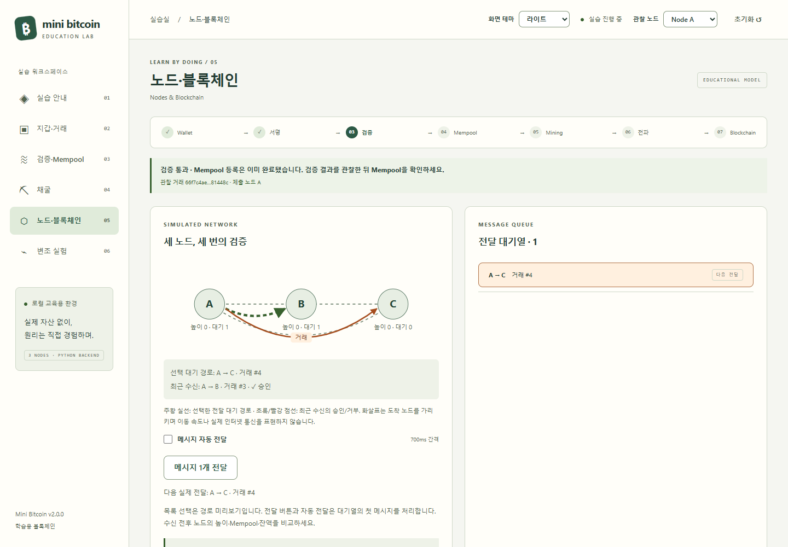
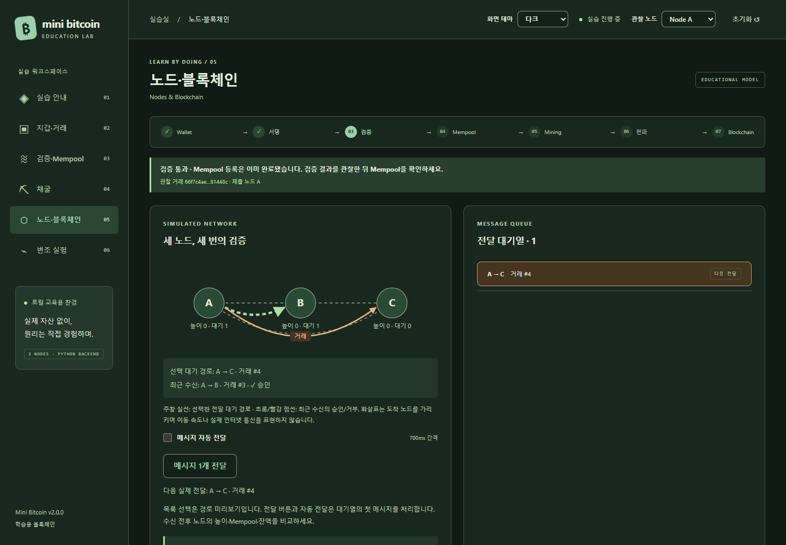
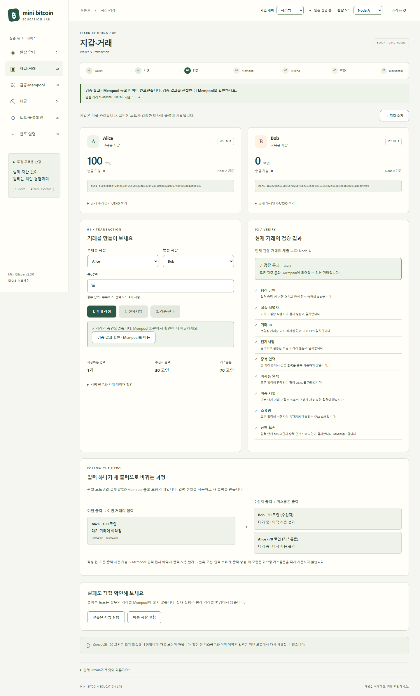
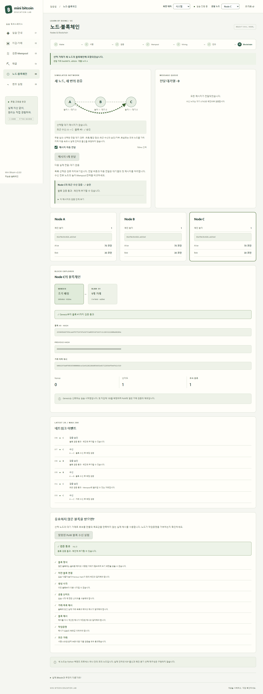
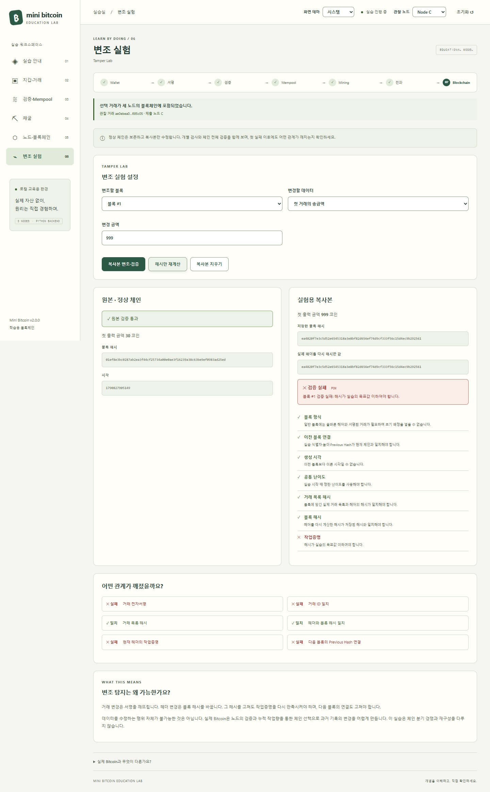
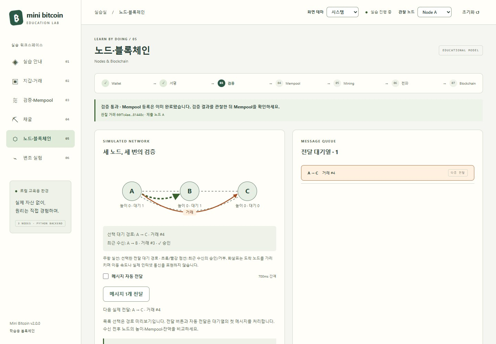

# 결과보고서 초안

## 과제명

비트코인 핵심 동작 원리 학습을 위한 웹 기반 교육용 블록체인 시스템 설계 및 구현

> 개인 구현 결과를 설명하기 위한 초안이다. 제출용 표지·소속·지도교수·작성자·최종 제출일은 학교 양식에 맞게 작성한다. 제공된 수행계획서의 팀원 정보를 개인 구현의 기여자로 자동 기재하지 않는다.

## 1. 연구 목적과 필요성

입문자는 전자서명, 해시, 채굴, 노드를 개별 용어로 접하지만 이들이 거래 처리 과정에서 어떻게 연결되는지 이해하기 어렵다. 본 작품은 거래를 직접 작성하고 각 상태의 변화를 관찰하도록 하여 서명·거래 검증·작업증명·블록 연결·노드 검증의 역할을 구분하는 데 목적이 있다.

실제 Bitcoin을 복제하거나 실자산을 거래하지 않는다. 한 PC에서 재현할 수 있는 축소 모델을 만들고, 단순화한 부분을 화면과 문서에 명시한다.

## 2. 설계와 기술 선택

시스템을 화면과 규칙으로 나누었다. 화면은 React·TypeScript·Vite로 만든 브라우저 앱이며 실습 상태를 표시하고 사용자의 조작을 요청으로 보낸다. 규칙은 Python·FastAPI 백엔드가 수행한다. 지갑과 개인키 보관, 거래 작성과 서명, 검증, 모의 노드, 채굴, 실패 실험이 모두 백엔드에 있고 브라우저에는 서명·검증·해시 코드가 없다. 화면은 같은 출처의 `/api`만 호출하고 화면 서버가 이를 백엔드로 전달한다. DB는 두지 않으며 실습 상태는 백엔드의 메모리에 유지한다. 모의 노드 세 개는 각자의 체인·UTXO·Mempool을 보유하며, 전달받은 거래·블록을 동일 규칙으로 독립 검증한다.

암호 연산은 Python 표준 라이브러리의 SHA-256과 `cryptography` 라이브러리의 secp256k1 ECDSA를 사용한다. 핵심 검증 로직은 HTTP·FastAPI에 의존하지 않는 순수 Python 함수로 작성하여 단위 테스트와 설명이 가능하도록 했다. 반복 해시 계산도 백엔드가 수행한다. 백엔드는 스스로 시간을 재며 돌지 않고, 화면이 계산을 요청할 때마다 짧은 묶음을 계산해 결과를 돌려준다. 그 사이에 일시정지·중지 요청을 처리할 수 있어 화면이 멈추지 않는다.

## 3. 핵심 구현

### 3.1 지갑·거래·UTXO

암호학적 난수로 개인키를 만들고 공개키와 교육용 주소를 계산한다. 잔액은 주소에 대응하는 확정 UTXO의 합이며 Wallet 객체에서 직접 증감하지 않는다. 송금 시 필요한 입력을 고르고 수신 출력과 거스름돈 출력을 만든다. 한 거래의 입력은 한 지갑 소유로 제한한다.

원문 필드 순서를 고정한 JSON에 SHA-256을 적용하고 서명한다. 노드는 서명·소유권·사용되지 않은 입력·금액 보존·중복 입력·이중 지출을 검사한다. 미확정 거래는 Mempool에만 저장하고 입력을 예약한다.

### 3.2 PoW·블록·체인

후보 블록을 고정하고 Nonce를 바꾸며 목표값 이하의 실제 해시를 찾는다. 난이도는 선행 16진수 0의 개수 1~4로 제한하고 실습마다 고정한다. 단계 실행·빠른 연속 실행·약 250ms마다 하나씩 계산하는 학습 실행·일시정지·재개·중지를 제공한다. 최근 12개 실제 계산 결과의 목표값 통과 여부를 비교하고 전체 시도 횟수를 표시한다. 실제 계산 시간과 학습 관찰 대기 시간을 분리하며 평균 속도는 실제 계산 시간만 사용한다. 첫 계산이 성공해도 그대로 인정한다.

블록 수신 시 현재 tip 연결, 난이도, 거래 목록 해시, 헤더 해시, PoW 및 모든 거래를 검사한다. 검증 완료 후에만 UTXO와 체인을 갱신하여 부분 반영을 막는다. 전체 체인 검증은 Genesis부터 UTXO를 다시 구성한다.

### 3.3 노드 전달과 변조 실험

메시지를 자동 또는 한 건씩 전달할 수 있다. 수신·검증·승인·거부 이벤트를 분리 기록하여 “받음”과 “검증됨”의 차이를 보여준다. 다음 채굴은 이전 블록 전달 후에만 허용하여 체인 분기 구현을 범위에서 제외했다.

처음에는 수동 전달로 시작하여 노드별 상태 차이를 관찰한다. 선택 메시지의 실제 출발·도착·거래/블록 종류를 도식에 표시하고, FIFO 순서의 다음 실제 전달과 구분한다. 처리한 메시지의 수신 경로와 실제 검증 결과를 남겨 전후 상태를 비교할 수 있다. 상단 흐름은 선택 거래의 작성·서명·검증과 실제 블록 포함 사건을 추적하며, 검증 실패는 완료 표시를 하지 않는다. 화면 이동 후에도 같은 거래를 관찰하고 새 거래를 작성하면 별도 흐름을 시작한다.

변조 실험은 정상 체인을 복사한 뒤 거래 금액이나 블록 시각을 수정한다. 서명, 거래 ID, 데이터 해시, PoW, 후속 Previous Hash 연결을 따로 검사한다. 해시만 고치는 것으로 모든 검증이 복구되지 않음을 보여준다.

### 3.4 화면 테마와 버전 관리

1.1.0은 기존 교육 화면 개선과 라이트·다크·시스템 테마 선택을 묶은 업데이트다. 처음에는 운영체제 색상을 따르며, 명시적인 테마 선택만 브라우저에 저장한다. 테마 변경은 CSS 변수와 문서의 표시 설정을 바꾸므로 거래·검증 결과·체인·채굴 작업을 유지한다. 지갑·개인키·실습 상태는 저장하지 않는다. 앱의 버전은 frontend/package.json에서 자동으로 읽고, 잠금 파일과 백엔드의 프로젝트 버전도 같은 값으로 관리한다.

### 3.5 화면과 백엔드의 분리

2.0.0에서 브라우저 안에 있던 TypeScript 핵심 로직과 Web Worker를 Python 백엔드로 옮겼다. 화면에 보이는 실습 절차는 그대로 두고, 규칙을 계산하는 위치와 구현 언어를 바꾼 변경이다.

- **규칙은 한 곳에만 있다.** 같은 규칙을 두 언어로 중복 구현하지 않는다. 화면이 직접 계산하던 잔액·예약 입력·체인 검증 결과·목표값도 백엔드가 계산해 실습 상태와 함께 보낸다.
- **데이터 형식을 유지했다.** 서명 원문, 거래 ID, 거래 목록 해시, 블록 해시, 주소의 형식은 1.1.0과 같다. TypeScript 코드를 삭제하기 전에 고정 키·실습 ID·시각으로 기준값을 기록했고, Python 구현이 같은 주소·서명·거래 ID·블록 해시와 단계별 검증 결과를 재현하는지 자동으로 검사한다.
- **검증 실패와 오류를 구분한다.** 규칙에 맞지 않는 거래·블록은 오류가 아니라 이유를 담은 검증 결과로 응답한다. 요청 자체를 처리할 수 없는 경우에만 한국어 메시지를 가진 오류로 응답한다.
- **개인키는 실습 상태에 넣지 않는다.** 백엔드가 보관하고, 화면의 개인키 펼쳐 보기를 열 때만 전용 경로로 전달한다.
- **요청 순서를 지킨다.** 화면은 조작을 누른 순서대로 한 번에 하나씩 보내고, 초기화 뒤에 늦게 도착한 이전 실습·이전 채굴 작업의 응답은 실습 ID·작업 ID·순번으로 가려내 무시한다.

## 4. 검증 방법과 관찰 결과

자동 테스트는 세 층으로 구성한다. 백엔드의 pytest는 암호·거래·블록 규칙, 원자적 반영, 노드 독립성, 중복·충돌 처리, 채굴 작업의 단계·일시정지·시간 집계, 실패 실험, HTTP API와 1.1.0 기준값 재현을 검사한다. 화면의 Vitest는 학습 단계 계산·메시지 경로 도식·요청 순서 제어·테마를 검사한다. Playwright는 Chrome/Edge에서 두 서버를 함께 실행해 실제 학습 흐름을 검사한다. 정확한 실행 결과·환경·확인 범위는 [테스트 기록](test-results.md)에 둔다.

대표 기능 관찰은 다음과 같다.

| 실험 | 결과 해석 |
|---|---|
| Alice의 100에서 Bob에게 30 전송 | Mempool 단계의 확정 잔액은 100/0, 블록 반영 후 70/30 |
| 같은 입력으로 다른 거래 제출 | 이미 예약된 입력을 감지하여 이중 지출 거부 |
| 잘못된 서명 제출 | 공개키 검증에 실패하고 Mempool에 넣지 않음 |
| 목표값을 만족하지 않는 블록 수신 | PoW 단계에서 거부하고 기존 체인 보존 |
| 수동 메시지 전달 | 수신 전 노드 상태가 다를 수 있고, 전달·검증 후 일치 |
| 과거 거래 금액 변경 | 거래 데이터 해시와 전자서명·거래 ID의 불일치 확인 |
| 변조 후 해당 블록 해시만 재계산 | 서명 또는 PoW·후속 연결 실패가 남으며 원본 체인은 보존 |
| 초기화 후 늦게 도착한 이전 채굴 작업의 응답 | 실습·작업 식별자로 무시하여 새 실습에 반영하지 않음 |
| 백엔드를 실행하지 않고 실습 시작 | 연결할 수 없다는 안내를 표시하고, 백엔드 실행 후 같은 화면에서 다시 시작 |
| 같은 고정 입력을 1.1.0 TypeScript와 2.0.0 Python으로 계산 | 주소·서명·거래 ID·블록 해시·검증 결과 일치 |

이 결과는 프로그램의 기능적 동작 검증이다. 학생 대상 사전·사후 학습 실험을 수행한 것은 아니므로 교육 효과의 정량적 향상을 입증했다고 주장하지 않는다. 난이도별 평균 성능도 통계 실험 없이 일반화하지 않는다.

## 5. 화면 자료

아래 캡처는 모두 2.0.0(화면과 Python 백엔드 분리 후)의 실제 실행 화면이다.

### 테마 대표 화면

여섯 화면의 라이트·다크 캡처와 실제 검증 범위는 [테스트 기록](test-results.md)에 정리한다.

### 학습 흐름 캡처

화면은 실제 로컬 실행에서 캡처한 예시이며 키·해시·Nonce 값은 실습마다 달라진다. 개인키 펼쳐 보기 상태는 발표 캡처에 사용하지 않는다.

## 6. 한계와 논의

Genesis의 100 코인 배정, 교육용 주소와 JSON·단일 SHA-256, Merkle Tree 대신 전체 목록 해시, 고정 난이도, 단일 채굴 작업, 백엔드 프로세스 하나 안의 모의 전달이 주요 단순화다. 채굴 보상·수수료 정책·실제 P2P·체인 분기와 누적 작업량 선택·재구성·실습 상태의 영속 저장은 구현하지 않는다. 저장되는 설정은 화면 테마 선택값뿐이며 지갑·개인키·블록체인은 새로고침이나 백엔드 재시작 시 초기화된다.

화면과 백엔드를 나누었지만 세 노드는 여전히 한 프로세스 안에 있다. 서로 다른 세 프로세스나 세 장치에서 실제 통신하는 분산 시스템은 아니다. 노드들이 같은 검증 함수를 사용하므로 구현 버그가 공통으로 영향을 줄 수 있다. 이는 교육용 모델의 한계이며 실제 Bitcoin 네트워크의 안전성을 검증하는 실험으로 해석하면 안 된다.

개인키를 백엔드가 보관하고 서명하는 구조는 사용자의 기기에서 서명하는 실제 지갑과 다르다. 규칙을 한 곳에 두기 위한 선택이며, 백엔드는 이 PC의 `127.0.0.1`에서만 요청을 받는 단일 사용자 학습 환경을 전제로 한다. 인증이나 여러 사용자 사이의 격리는 다루지 않는다.

채굴 계산은 화면의 요청이 있을 때만 진행된다. 화면 없이 백엔드가 혼자 채굴을 이어 가지 않으며, 브라우저가 보이지 않는 탭의 타이머를 늦추면 채굴도 느려진다. 실행에는 Node.js와 Python 두 도구가 필요하고 서버 두 개를 함께 실행해야 한다.

## 7. 결론과 제출 준비

거래 생성에서 블록체인 기록까지 연결된 실습과 실패 사례 관찰을 제공한다. 학생은 화면에 표시된 데이터를 백엔드의 핵심 Python 함수와 대응하여 설명할 수 있다. 최종 제출 전 학교 양식 반영, 발표자 리허설, 시연 영상 촬영을 수행한다. 이 초안과 시연 대본은 해당 준비를 지원하며 실제 영상 파일은 별도 산출물이다.

## 참고 문헌

- Bitcoin Developer Guide, [Transactions](https://developer.bitcoin.org/devguide/transactions.html), [Block Chain](https://developer.bitcoin.org/devguide/block_chain.html)
- [cryptography: Elliptic curve cryptography](https://cryptography.io/en/latest/hazmat/primitives/asymmetric/ec/)
- [RFC 6979: Deterministic Usage of DSA and ECDSA](https://www.rfc-editor.org/rfc/rfc6979)
- [FastAPI 공식 문서](https://fastapi.tiangolo.com/), [uv 공식 문서](https://docs.astral.sh/uv/)
- [Vite 공식 문서](https://vite.dev/guide/)
- 1.1.0까지 사용한 [noble-curves](https://github.com/paulmillr/noble-curves), [noble-hashes](https://github.com/paulmillr/noble-hashes): 2.0.0의 기준값을 만든 구현
