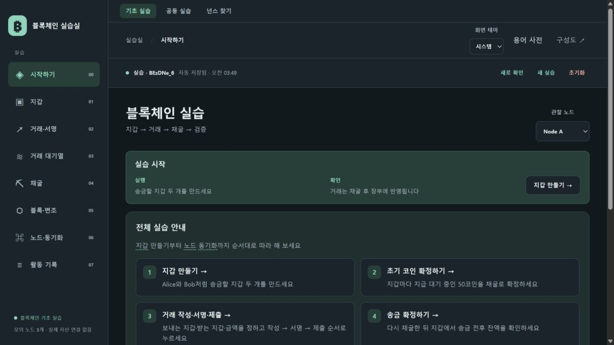

# 블록체인 실습실 결과보고서

현재 팀 앱 기준 · 2026-11-17

과제명: 직접 조작과 공동 실습을 지원하는 교육용 블록체인 웹 앱

공개 서비스: [blockchain-practice.onrender.com](https://blockchain-practice.onrender.com)

팀 브랜치: `blockchain-practice`

실행 소스: `experiments/blockchain-practice/`

앱 버전: 3.0.0

이 보고서는 현재 팀 앱의 구현과 확인된 관찰을 설명합니다 작성자·소속·팀원별 기여·학교 제출일은 실제 수행 내역과 학교 양식에 따라 별도로 작성합니다 개인 본체와 팀 앱은 독립적으로 관리하며, 이전 개인 React 결과보고서는 [보관 문서](archive/personal-react/docs/final-report.md)에 있습니다

## 목적과 현재 제공 범위

입문자는 지갑·전자서명·해시·채굴·노드를 개별 용어로 접하지만 실제 거래 흐름에서 각 기능의 역할을 구분하기 어렵습니다 블록체인 실습실은 작성·서명·제출·채굴·노드 검증을 단계별 조작으로 연결하고, 정상 결과와 변조 실패를 같은 화면에서 비교하도록 구성했습니다

현재 첫 화면은 간단한 계정 모델의 **기초 실습**입니다 **공동 실습**에서는 팀원이 같은 링크와 장부를 공유하고, **넌스 찾기**에서는 접속한 기기의 CPU·GPU로 해시 조건을 직접 찾습니다 실제 자산이나 Bitcoin 네트워크에는 연결하지 않습니다

| 공개 화면 | 주요 학습 내용 | 상태 보존 |
| --- | --- | --- |
| 기초 실습 | 지갑·서명·거래 대기열·한 노드 채굴·세 노드 비교·Merkle 검증·변조·동기화 | 서버의 분리된 기초 실습 저장소 |
| 공동 실습 | UTXO·수수료·입력 예약·거스름돈·역할·실시간 전파·단일 채굴·경쟁 | 방 코드에 연결된 서버 장부 |
| 넌스 찾기 | 메시지와 넌스의 SHA-256·난이도·CPU/GPU 계산·해시 재검증 | 최근 결과 50개를 현재 브라우저에 저장 |

이전 통합 실습·보관함은 `/advanced` 호환 경로에 남겨 두고 공개 메뉴에서는 제외했습니다 기초·공동 장부는 규칙이 다르므로 자동 변환하거나 합치지 않습니다

## 설계와 실행 구조

```text
PC·휴대폰 브라우저
  ├ 기초 HTML·CSS·JavaScript
  ├ 공동 React·TypeScript 화면 ─ HTTP·WebSocket
  └ 넌스 Web Worker·Web Crypto·WebGPU
                │ HTTPS·WSS
Render Free ─ Gunicorn 단일 프로세스 ─ Flask API·모의 A/B/C 노드
                │
          Neon PostgreSQL ─ 기초·공동·보관함·소유 정보
```

로컬 실행은 Python 3.13·Node.js 24와 `Start-Team.cmd`를 사용하며 SQLite에 저장합니다 운영은 Docker 이미지에서 Gunicorn·Flask를 실행하고 외부 PostgreSQL에 기록을 보존합니다 Node.js는 화면 빌드 단계에 사용합니다 활성 실습·채굴 실행기는 단일 프로세스에서 관리하므로 현재 설정을 임의로 여러 worker나 서버로 확장하지 않습니다

기초 Python 코어와 공동 UTXO 엔진은 별도 모듈입니다 공동 엔진과 React 화면은 개인 본체의 소스를 팀 앱 안으로 독립 복사한 뒤 연결했으며, 출처와 복사 당시 해시는 `education_engine/PROVENANCE.json`에 보존합니다 개인 프로젝트의 DB·쿠키·실행 서버는 참조하지 않습니다

## 주요 구현

### 기초 실습과 세 노드 비교

새 지갑마다 50코인 지급 거래가 대기열에 들어가며, 블록에 포함된 뒤 사용할 수 있습니다 잔액은 선택한 노드의 체인 거래를 합산해 계산합니다 송금은 실제 secp256k1 서명을 만들고 수신 노드가 서명·잔액·거래 순번을 확인합니다

한 노드 채굴은 Nonce를 바꾸며 실제 SHA-256을 계산합니다 한 번 계산·느린 실행·연속 실행·일시정지·재개·중지를 제공하고 유효 블록에 보상 10코인을 기록합니다 난이도는 1~5 범위와 높이별 정책을 사용합니다

세 노드 비교는 A/B/C가 같은 장부 끝에서 각각 후보 블록을 만들고 번갈아 실제 해시를 계산합니다 첫 발견 시 계산을 멈추고 연결된 노드에 전파·검증합니다 시도 횟수·Nonce·해시·계산 시간·발견 노드와 블록 전달 결과를 표시합니다 이 비교는 한 서버 안의 교육 실행이며 물리적 장치 세 대의 성능 측정은 아닙니다

블록 검증은 Genesis·Merkle Root·블록 해시·PoW·이전 연결·거래 규칙을 확인합니다 변조 화면에서는 선택 노드의 거래 내용만 바꾸기, Merkle·해시 재계산, 이후 블록 재채굴을 구분합니다 유효 체인을 가진 다른 온라인 노드와 동기화해 무효 노드를 복구할 수 있습니다 누적 작업량이 같은 유효 체인은 현재 체인을 유지합니다

### 공동 실습과 쉬운 진행

팀원은 교사 접속 없이 별명으로 들어와 비어 있는 A/B/C 역할을 직접 맡습니다 혼자라면 A만 맡아도 B/C 노드가 거래와 블록을 검증합니다 쉬운 실습은 현재 필요한 버튼 하나를 제시하며 초안 작성·서명·전송·채굴을 각각 실제 명령으로 수행합니다

기본 초기 배정은 팀마다 100코인입니다 명시적으로 새 실습을 만들 때는 팀별 금액을 1~10000 정수로 선택하고 별도 링크에 보관합니다 추가 입장·재접속은 초기 코인을 다시 지급하지 않습니다

공동 장부는 UTXO 모델로 입력 예약·거스름돈·수수료를 계산합니다 초기 100 입력으로 송금 10·수수료 1을 제출하면 입력 전체가 예약되고 블록 반영 후 89의 거스름돈이 생깁니다 채굴 보상은 별도 보상 지갑에 기록하며 100블록 성숙 규칙을 적용합니다 기초 장부의 50 지급·10 보상과 다른 규칙입니다

실시간 연결은 참가 권한·실행 ID·명령 순서를 확인합니다 완료 가이드는 선택한 거래의 실제 수신·블록 포함·현재 체인 일치를 판정합니다 설명 화면을 넘기는 행동을 완료로 처리하지 않으며 분기나 재구성으로 실제 결과가 달라지면 표시도 갱신합니다

### 넌스 찾기와 선택형 PC 엔진

넌스 규칙은 원본 해시캐시 실습과 같은 단일 `SHA256(UTF8(메시지 + 10진수 넌스))`입니다 원문의 공백·줄바꿈을 유지하고 uint64 넌스 범위를 확인합니다 난이도는 앞의 16진수 0 개수입니다

브라우저 CPU·GPU·CPU+GPU·자동 모드를 제공하며 실제 장치·완료 계산 수·전환 이유를 표시합니다 GPU를 사용할 수 없거나 검증에 실패하면 CPU로 전환합니다 발견한 결과는 별도 SHA-256 재계산으로 확인하고 최근 50개를 현재 브라우저에 보관합니다

Python·C 고급 엔진은 명시적으로 켠 로컬 PC의 루프백 요청에서만 실행합니다 무료 공개 서버에서는 비활성 상태입니다 CPU+GPU가 항상 빠르거나 최소 넌스를 먼저 찾는다고 설명하지 않습니다

### 저장·재연결·사용성

온라인 기초·공동 기록은 외부 PostgreSQL에 저장해 서버 재시작 후 같은 소유 연결과 공동 링크로 이어갑니다 연결 복구는 읽기 요청을 재시도하고 변경 명령을 자동 재전송하지 않습니다 역할과 진행 권한은 재확인하며 계산은 필요한 경우 사용자가 다시 시작합니다

기초 시작하기의 6단계, 동적인 다음 할 일, 공동 쉬운 실습·완료 체크, 점선 용어·용어 사전·구성도로 안내를 제공합니다 기초·공동·넌스는 공통 시스템·라이트·다크 테마를 사용합니다 최신 실제 조작 영상은 6단계 안내 아래에 접어 두고 사용자가 재생할 때만 불러옵니다

## 확인 근거와 관찰 결과

자동 검사와 운영 확인의 날짜·환경·건수는 [팀 검증 기록](../experiments/blockchain-practice/VERIFICATION.md)에 관리합니다 이 문서 갱신은 해당 검사를 새로 실행한 기록을 추가하지 않습니다 상세 운영 구성과 무료 서비스 제한은 [배포 안내](../experiments/blockchain-practice/DEPLOYMENT.md)를 기준으로 합니다

기존 기록에는 Python 규칙·API·저장 실패·서버 교체 검사, Chrome/Edge 실제 조작, 모바일 배치, HTTP·WebSocket·PostgreSQL 복원 확인이 포함됩니다 환경 변수가 필요한 검사의 건너뜀과 실제 운영 확인을 구분하며 테스트 개수를 누적 합산해 현재 전체 통과 수로 표현하지 않습니다

2026-11-17 실제 운영 화면 시연에서 관찰한 결과는 다음과 같습니다 기존 팀원의 장부와 분리한 시연 실습을 사용했습니다

| 시연 | 관찰 결과 |
| --- | --- |
| 기초 지급·송금 | 두 지갑 각 50 지급 확정 후 Alice가 Bob에게 20 송금, 최종 Alice 30/Bob 70 |
| 기초 세 노드 비교 | 해당 실행에서는 B가 먼저 발견, A/B/C 실제 시도 13/13/12와 서로 다른 실제 해시 표시 |
| 공동 혼자 실습 | 초기 각 100에서 송금 10·수수료 1, A89/B110/C100과 완료 6/6 확인 |
| 공동 저장·재접속 | 지금 저장 후 새로고침해 같은 방 링크와 기록 유지 확인 |
| 넌스 CPU 계산 | 해당 메시지·시작 0에서 넌스 3055, 3056회 계산, 선행 000 해시와 독립 재검증 일치 |
| 넌스 결과 보존 | 새로고침 뒤 같은 브라우저의 찾은 기록 유지 확인 |

발견 노드·Nonce·시도 횟수는 이 실행의 관찰값이며 다음 실행의 보장값이 아닙니다 서버 재시작 복원은 별도의 운영·프로세스 교체 검사 근거와 구분합니다 학생 대상 사전·사후 연구는 수행하지 않았으므로 학습 효과가 정량적으로 향상됐다고 주장하지 않습니다

## 현재 화면과 시연 자료



[최신 실제 조작 영상 · 4분 33초](../experiments/blockchain-practice/static/media/blockchain-practice-demo-20261117.mp4)는 기초 → 세 노드 비교 → 공동 → 넌스 순서로 진행하며 클릭 안내 한국어 자막을 포함합니다 전체 화면을 실제 조작한 연속 녹화에서 정지 대기 구간만 정리했고 확대·배속·사진 연결을 사용하지 않았습니다

영상은 2880×1980·30fps이며 앱의 2880×1800 화면 아래에 180px 자막 공간을 둡니다 실제 녹화 당시 값이 화면에 남아 있으므로 실습 설명용 예시로 사용합니다 [시연 대본](demo-script.md)은 이 영상의 흐름과 다시 실행할 때의 주의점을 설명합니다

이전 개인 앱의 캡처·테스트·문서는 [보관 폴더](archive/personal-react/)에 두며 현재 팀 앱의 화면이나 검증 결과로 사용하지 않습니다

## 한계와 후속 과제

- 실제 P2P·Bitcoin Mainnet·실제 자산·완전한 Script/주소/바이너리 직렬화를 제공하지 않음
- 한 서버 안에서 A/B/C를 관리하므로 실제 분산 합의 네트워크의 안전성을 입증하지 않음
- 기초 계정 장부와 공동 UTXO 장부의 규칙이 달라 학습 설명과 잔액 예시를 구분해야 함
- 무료 서버의 준비 시간·사용 한도·재배포 중 단절이 있으며 무중단을 보장하지 않음
- 넌스 기록은 브라우저 저장이므로 다른 기기 공유·공동 장부 동기화 대상이 아님
- 대규모 동시 접속·장기 운영·운영자 백업 복구 훈련과 교육 효과 연구는 별도 과제

현재 결과물은 서버 저장과 팀 공동 조작을 갖춘 교육용 앱입니다 제출 전에는 작성자·기여 내역·학교 양식과 실제 발표 환경을 확인하고, 본 보고서의 현재 상태와 날짜가 있는 과거 검증을 구분해 사용합니다

## 구현·운영 참고 자료

- [앱 실행과 모델 범위](../experiments/blockchain-practice/README.md)
- [사용 안내](user-guide.md) · [요구사항](requirements.md)
- [서버·저장·배포 설정](../experiments/blockchain-practice/DEPLOYMENT.md)
- [검증 기록](../experiments/blockchain-practice/VERIFICATION.md)
- [원본 엔진 출처](../experiments/blockchain-practice/education_engine/PROVENANCE.json)
