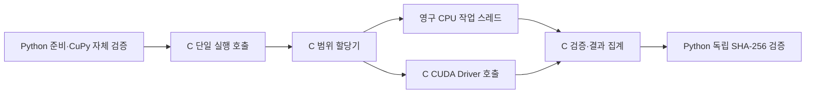

# 작업 배분·결과 전달·CUDA 호출까지 C로 옮긴 실험

검증일: **2026-10-17 KST**. 기준선은 `3d9091a048aa34139682f4a8bf190a20004d0e30`.
Intel Core Ultra 7 356H / RTX 5070 Laptop GPU, Windows, NVIDIA 591.74,
Python 3.13.15, CuPy 14.2.0, GCC 16.2.0, OpenSSL 3.6.5에서 확인했다.

사용자의 제안대로 관리 경로를 C로 옮기자 **이번 조건에서는 CPU+GPU가 GPU 단독보다
빨라졌다.** 준비 완료 후 고정 계산량의 처리량은 기존 Python GPU 단독보다 약
**3.6~4.3%**, C로 관리하는 GPU 단독보다 약 **2.9~3.3%** 높았다.
이는 이 PC·측정 입력·배치·작업 수에 대한 결과이며 모든 입력과 시작 비용의 개선을 뜻하지 않는다.

## 이전 실험과 달라진 점

[앞선 실험](hashcash-bottleneck-20261016.md)은 CPU 해시 루프만 C로 옮기고 Python이
작업을 배정했다. 이번에는 다음을 모두 C DLL의 한 호출 안에서 수행한다.

- Win32 persistent CPU worker 4개와 SRWLOCK 중앙 범위 할당
- CPU 계산이 끝나면 GPU 배치 종료를 기다리지 않고 다음 CPU 범위 배정
- CUDA Driver API로 동일 SHA-256 커널 실행, 플래그 초기화, pinned buffer readback
- 결과의 OpenSSL 재검증, 첫 proof 확정, 처리량·범위·타임라인 집계
- GPU 실패 범위의 CPU 재시도와 취소 후 이미 배정한 작업 정리



측정 중 Python callback·Pool IPC·배치별 Python polling은 없다. 테스트용 fake GPU
callback은 별도 correctness 경로로만 사용한다. 같은 CuPy backend를 공유하는 실행은
순차적으로만 허용한다. CUDA context는 호출 스레드에 연결되므로 C bridge가 필요한 경우
push/pop하며, stream 완료 후 host buffer를 읽는다.
[NVIDIA context 문서](https://docs.nvidia.com/cuda/archive/12.9.1/cuda-driver-api/group__CUDA__CTX.html)

SHA-256 CUDA 커널과 256 threads × 16 trials geometry는 기준선 그대로다.
GPU 배치는 67,108,864, 선택한 CPU 배치는 64,000이다. CPU의 실제 추가 기여를
구분하기 위해 **Python GPU 단독 / C GPU 단독 / C CPU4+GPU**를 모두 비교했다.

## 유한 후보와 독립 재확인

[사전 계획](hashcash-native-scheduler-plan-20261017.md)에 따라 CPU 1/4/8개 × CPU 배치
64k/250k/1M의 9개 후보를 같은 4,294,967,296개 nonce·난이도 8에서 7회 교대했다.
첫 탐색에서 CPU4/64k를 선택한 뒤, 별도의 새 표본 13회로 세 입력을 확인했다.
유한 종료점을 이용해 CPU 작업을 미리 끊는 tail guard는 **0**으로 두었다.

각 입력의 모든 변형은 같은 시작값과 같은 nonce 집합을 끝까지 처리했다.
ASCII·한국어 시작은 1,000,000,000, 20자리 시작은 10,000,000,000,000,000,000이다.
구간을 정렬해 중복·누락을 검증하고 모든 proof와 각 배치 끝 해시를 hashlib로 재검산했다.
모든 worker가 실제 CPU warmup에 참여했는지 확인했고, 두 대조군 실행 중에도 같은
persistent context와 유휴 스레드를 유지했다. GPU 측정은 한 담당자만 수행했다.

| 13회 중앙 처리량 | Python GPU | C GPU | C CPU4+GPU | 기존 대비 | C GPU 대비 |
|---|---:|---:|---:|---:|---:|
| 28B ASCII·10자리 nonce | 4.7724 GH/s | 4.8043 GH/s | **4.9461 GH/s** | **+3.64%** | **+2.95%** |
| 한국어·10자리 nonce | 4.7347 GH/s | 4.7797 GH/s | **4.9364 GH/s** | **+4.26%** | **+3.28%** |
| 28B ASCII·20자리 nonce | 4.5258 GH/s | 4.5651 GH/s | **4.6955 GH/s** | **+3.75%** | **+2.86%** |

동시 모드는 세 입력 모두 두 대조군에 **각각 13/13회 승리**했다. 표의 백분율은
처리량 중앙값의 비율이다. 원시 자료에는 개별 표본·대조군 대비 중앙값 비율·변동과 실행 순서가 있다.
GPU 단독의 C 이전만으로 생긴 개선과, C GPU에 CPU를 추가한 개선을 혼동하지 않았다.

CPU가 맡은 계산은 전체의 약 **2.0%**였다. GPU 커널 자체 처리율은 비슷했고,
기존 Python 관리 비용이 줄면서 작은 CPU 기여가 실제 이득이 된 것으로 해석할 수 있다.
8개 작업이나 1M CPU 배치는 더 빠르지 않았다. 큰 CPU 배치는 마지막 CPU 작업을
기다리는 시간이 늘고, 코어를 늘리면 이 PC의 다른 자원·전력 조건과 경쟁할 수 있다.
전력·열·스케줄링 각각의 인과 비중을 이 실험만으로 확정하지 않았다.

## 실제 proof·시작 비용·취소

고정 계산량과 별개로 기본 메시지의 난이도 8 proof를 실제로 새로 계산했다.
C GPU 단독과 C 동시 모드 모두 nonce `3243428010`을 찾았고 독립 SHA-256이
`000000002414c5ac2781b41a79da1a3cda116fd3133f9767d362a169f45c1efa`와 일치했다.
정답 nonce의 최소 일치는 검증 조건으로 사용하지 않았다.

초기 기능검사 한 번은 C GPU의 first proof가 0.455초, C 동시 모드가 0.466초로
오히려 조금 늦었다. 이를 숨기거나 유리한 한 번을 고르지 않고 보존했다. GPU·CPU의
워밍업 조건을 맞추지 않은 한 번의 시간으로 일반적인 발견 속도를 결론 내릴 수 없다.

그다음 같은 기본 메시지·시작·목표에서 **준비 완료 후 실제 탐색을 13회 교대**했다.
이전 proof를 재사용하지 않고 매번 새로 계산했다. 독립 검증 후 호출이 반환하기까지
측정했으므로 C CPU 작업 정리 시간도 포함한다.

| 실제 탐색 | 중앙 반환 시간 | Python GPU보다 빠른 횟수 | C GPU보다 빠른 횟수 |
|---|---:|---:|---:|
| Python GPU | 0.4794초 | — | 4/13 |
| C GPU | 0.4763초 | 9/13 | — |
| C CPU4+GPU | **0.4607초** | **13/13** | **12/13** |

이 결과는 한 메시지를 반복한 값이며 모든 메시지의 확률적 발견시간 분포를 증명하지
않는다. GPU 초기화·컴파일·DLL 빌드·CPU thread 준비는 이 표에서 제외했다.
별도 초기 기능검사의 CUDA backend 준비는 0.351초였고, 사전 존재하는 compiler disk
cache를 유지했다. 진짜 빈 compiler cache의 cold start 측정으로 해석하면 안 된다.
새 메시지에는 모든 1~20자리 CUDA function을 준비하는 비용이 추가될 수 있다.

다른 스레드에서 실행 중 취소를 요청한 실제 CUDA 검사를 통과했다. 관측한 취소 후
정리 시간은 12.2ms였으며 이후 같은 coordinator를 reset해 100,003개 nonce를 정확히
계산했다. 이 한 번의 값은 모든 하드웨어·전력 상태의 최악 취소 지연 한도가 아니다.

## 정확성·버전·검증

입력은 `SHA256(UTF8(message) || ASCII(decimal_nonce))` 그대로다. 공백·개행·NUL·Unicode,
uint64 끝·자리수 경계, GPU 실패 재시도, 취소·재시작, proof 이후 오류, trace overflow를
검사했다. CPU worker와 CUDA host 구간은 QPC, 커널 시간은 CUDA event로 기록했다.
다른 CPU 스레드의 QPC 시각 순서 불확실성을 감안해 GPU 구간마다 2 tick을 추가로 뺀
보수적인 실제 kernel overlap 하한을 확인했다. 이 PC의 QPC frequency는 10MHz다.
[Microsoft QPC 문서](https://learn.microsoft.com/en-us/windows/win32/sysinfo/acquiring-high-resolution-time-stamps)

독립 검토에서 발견한 running 중 error buffer 읽기와 QPC frequency 하드코딩을
정리하고, 최종 ASCII 13회를 다시 확인했다. 표의 ASCII는 최종 v2, 한국어와 20자리는
보존한 v1 소스의 결과다. **C 코드와 DLL은 동일하다.** v1의 10MHz 여유는 이 PC에서
v2의 실제 frequency 계산과 같았고, 수정은 측정 중 CUDA·CPU 경로를 바꾸지 않았다.
원시 묶음에 두 버전의 정확한 소스 bytes와 해시를 보존했다.

Python **109개**(실제 CUDA 9개 포함), TypeScript·lint·Vitest **41개**·빌드,
GPU opt-in Edge E2E **5개**를 확인했다. 제작과 독립 검증을 나눴고 원시 표본의
산술·범위·해시·소스·빌드를 별도로 재검증했다. 참가자 DB는 이 실험에 사용하지 않았다.
전체 검사 중 기존 HTTP 출처 검사에서 WinError 10053이 두 번 발생했다. 테스트가
응답 JSON을 끝까지 읽고 닫도록 정리한 후 전체 109개가 통과했다. 서버 출처 허용
정책은 바꾸지 않았고, 이 검사 이력도 원시 묶음에 남겼다.

## 실행과 재현

이번 추가물은 **Windows용 C 실험 실행 경로**다. 웹 화면의 기본 동시 모드에 자동으로
선택되도록 연결하지 않았다. 일반 사용자는 기존 CPU/GPU 실행을 계속 사용할 수 있다.
컴파일 산출물과 원본 파일은 `work/`에만 두고, C 소스·검증 도구·압축 원시 근거를 저장한다.

```powershell
# 기존 로컬 GCC/OpenSSL로 실험 DLL 빌드; 패키지를 설치하지 않음
.\.venv\Scripts\python.exe -m hashcash_lab.native_scheduler_experiment --build --self-test
# 다음 명령은 반드시 하나씩 완료한 뒤 다음 것을 실행
.\.venv\Scripts\python.exe -m hashcash_lab.native_scheduler_benchmark --stage screen --repeats 7 --output work/native-screen.json
.\.venv\Scripts\python.exe -m hashcash_lab.native_scheduler_benchmark --stage confirm --workers 4 --cpu-batch 64000 --profile ascii --repeats 13 --output work/native-ascii.json
.\.venv\Scripts\python.exe -m hashcash_lab.native_scheduler_benchmark --stage confirm --workers 4 --cpu-batch 64000 --profile korean --repeats 13 --output work/native-korean.json
.\.venv\Scripts\python.exe -m hashcash_lab.native_scheduler_benchmark --stage confirm --workers 4 --cpu-batch 64000 --profile digits20 --repeats 13 --output work/native-digits20.json
.\.venv\Scripts\python.exe -m hashcash_lab.native_scheduler_smoke --output work/native-smoke.json
.\.venv\Scripts\python.exe -m hashcash_lab.native_scheduler_search_benchmark --repeats 13 --output work/native-search.json
```

CUDA/CuPy 외에 이 실험에는 Windows Win32 API와 로컬 GCC/OpenSSL이 필요하다.
다른 OS·GPU·CuPy 버전에 대한 호환성을 확인한 것은 아니다. OpenSSL의 저수준 SHA API는
실험에 격리했다. [전체 원시 표본·소스·빌드·검증](hashcash-native-scheduler-20261017.json.gz)은
gzip JSON이며 Python 표준 `gzip`/`json`으로 읽을 수 있다.
