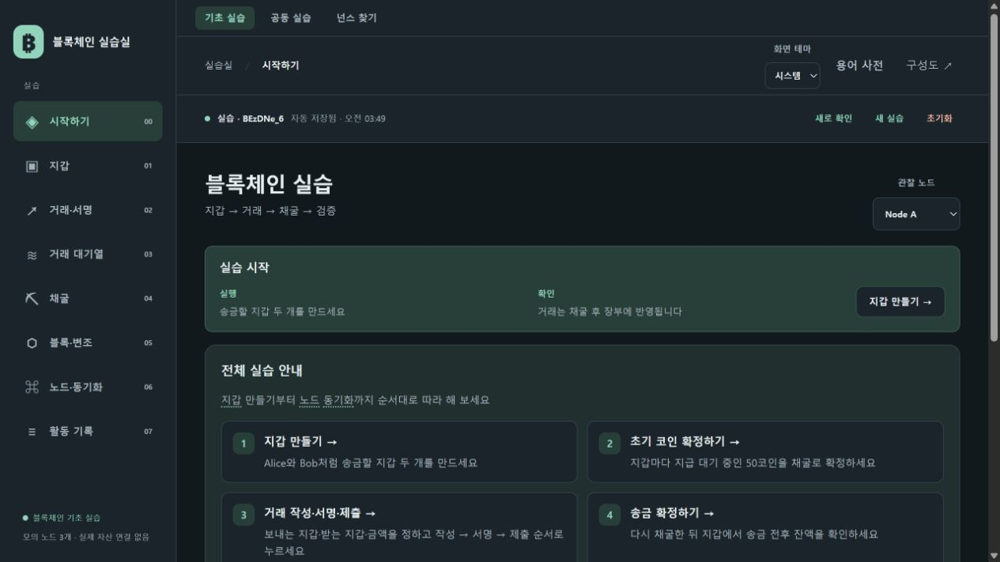

# 블록체인 실습실 검증 기록

기준일 **2026-11-17 (Asia/Seoul)** · 운영·앱 검사 대상 **`9fca79179e4f93cfbde089dfb24d043aa9a8b952`** · 팀 브랜치 `blockchain-practice`

2026-11-17 운영 배포 검사와 2026-11-20 가독성·영상 보완의 로컬 검사 결과를 기록합니다 초기 개인 React 모델의 19·36·41개 단위 검사와 과거 화면 캡처는 [과거 테스트 기록](archive/personal-react/docs/test-results.md)에 보관했습니다

## 환경과 검사 결과

로컬 환경은 Windows, Node.js **24.19.0**, npm **11.17.0**, Python **3.13.15**입니다 팀 UI는 React·TypeScript·Vite를 사용하며 실제 의존성 버전은 [팀 package.json](../experiments/blockchain-practice/frontend/package.json)과 잠금 파일, Python 의존성은 [requirements.txt](../experiments/blockchain-practice/requirements.txt)를 기준으로 합니다

| 검사 | 확인한 결과 | 범위 |
| --- | --- | --- |
| 팀 Python `unittest discover -s tests` | 총 **235개**, **218개 통과·17개 조건부 건너뜀**, 실패 없음 | 기초·UTXO·API·공동·저장·운영 진입점·PC 엔진 어댑터 회귀 |
| 팀 화면 `npm run check` | 타입·ESLint·**147개 단위 검사**·빌드 통과 | 18개 Vitest 파일, 공동·가이드·테마·넌스 규칙 등 |
| 저장소 루트 `npm run lint` | 통과 | 기존 개인 코드와 팀 정적 JS의 ESLint 경로 확인 |
| `test:blockchain:e2e -- --list` | **34개 목록 수집** | Chrome·Edge 구성과 새 폴더 경로 해석, 이 실행은 전체 E2E 통과 결과가 아님 |
| 새 실행 폴더의 로컬 서버 | 정상 | 이동한 가상환경의 Python·pip, `5020` 임시 포트의 현재 시작 화면 확인 |
| 운영 컨테이너 `production-restart` | 성공 | 실제 Docker 빌드·사이트 이전 역할·제한 자원·저장·정상 종료·새 컨테이너 복원 |
| 운영 컨테이너 `postgres-restart` | 성공 | PostgreSQL 통합·볼륨 없는 앱 교체·실습과 소유권 복원 |
| 기존 두 무료 서비스 배포 | 모두 Live | 같은 `9fca791`, primary와 legacy transfer 역할 유지 |
| 운영 브라우저 | 정상 | 기존 기초 실습 접근 정보 복원, 준비 중 안내 뒤 연결, 새 제품명·넌스 안내 표시 |

운영 CI의 커밋과 두 작업은 [실행 43961448887](https://github.com/jiho6367-design/mini-bitcoin-education/actions/runs/43961448887)에서 확인할 수 있습니다 로컬 조건부 건너뜀은 해당 테스트의 환경 전제에 따른 것이며, 별도 Linux PostgreSQL 통합 결과와 구분합니다 이 이름 변경 검증에서 모든 Chrome·Edge E2E를 다시 실행한 것은 아닙니다 이전의 실제 전체·부분 실행은 [상세 이력](../experiments/blockchain-practice/VERIFICATION.md)에 남겼습니다

## 운영 기록 보존 대조

배포 직전과 직후 PostgreSQL 데이터를 읽기 전용으로 대조했습니다 이 숫자는 해당 시점의 확인값이며 이후 사용자가 실습하면 늘어날 수 있습니다

| 데이터 | 변경 전후 결과 |
| --- | --- |
| 기초 실습 | 10개 전체 행·내용 동일 |
| 교육 실습 보관 기록 | 36개 전체 행·내용 동일 |
| 교육 이벤트 | 1,803개 전체 동일 |
| 소유권 연결 | 30개 전체 동일 |
| 공동 실습 링크 | 6개 동일 |
| 팀 참여자 | 12명 동일 |
| 기본 공동 실습 | 동일 실습 ID·장부·공동 이벤트 835개 |
| 체크포인트·저장 해시 | 모두 정상 |

DB 연결값·접속 키·실제 쿠키·개별 장부·개인 상태 파일은 공개하지 않습니다 브랜치·폴더·제품 이름 변경은 DB 접두어·소유자 서명·브라우저 저장소 키를 바꾸지 않았습니다 운영 상태의 공개 가능한 요약은 [release-status.json](release-status.json)에 있습니다

## 2026-11-20 가독성과 음성 보완 확인

구성도 본문과 용어 사전 풀이를 16px로 확대했습니다 Windows Chrome·Edge에서 구성도와 용어 사전의 검색·키보드·테마 동작을 확인했습니다 1440px PC와 390px 모바일 화면을 로컬에서 확인했습니다

팀 화면의 `npm run check`에서 타입 검사·ESLint·147개 단위 검사·빌드를 통과했습니다 Chrome·Edge 브라우저 검사 16건에서 영상 재생·재재생·탭 이동 시 일시정지, 기초·공동 실습 전환과 기록 유지, 모바일 가로 넘침 여부를 확인했습니다

현재 브랜치의 [한국어 음성 포함 시연 영상](../experiments/blockchain-practice/static/media/blockchain-practice-demo-narrated.mp4)은 273.033초, 2880×1980, 30fps입니다 오디오를 합친 뒤 원본과 동일한 영상 패킷과 한국어 AAC 발화를 확인했습니다 SHA-256은 `F9A1960F96FECC87D204A56DE65969195CB679F71176D91D07B2CC1D05B69442`입니다

## 2026-11-17 배포 당시의 영상과 화면

당시 배포한 시연 영상은 **273.033초(4분 33초)**, **2880×1980**, **30fps**이며 실제 마우스 조작과 한국어 클릭 자막을 담았습니다 기초 실습·세 노드 채굴 비교·공동 실습·넌스 찾기를 보여줍니다

- 영상: [blockchain-practice-demo-20261117.mp4](../experiments/blockchain-practice/static/media/blockchain-practice-demo-20261117.mp4)
- SHA-256: `1A2FFD7F97FABEC118394A9D9CE1C4AB571725425716E77CC4F1325A84AD3E62`
- 앱의 시작하기에서 접힌 **시연 영상 보기**로 제공, 기본 `preload=none`과 자동 재생 없음
- 앞선 영상 삽입 검증에서 실제 재생·부분 요청·모바일 390px·접기와 화면 이동 시 일시정지를 확인
- 아래 캡처는 현재 배포 코드 `9fca791`의 실제 시작 화면이며 옛 개인 모델의 캡처와 구분



## 로컬 재현 명령

저장소 루트에서 실행합니다 Python 가상환경과 프런트엔드 의존성이 없으면 먼저 [앱 실행 안내](../experiments/blockchain-practice/README.md)를 따릅니다

```powershell
cd experiments/blockchain-practice
.\.venv\Scripts\python.exe -m unittest discover -s tests
cd frontend
npm.cmd run check
cd ../../..
npm.cmd run lint
npm.cmd run test:blockchain:e2e -- --list
```

실제 브라우저 시나리오 실행은 `npm.cmd run test:blockchain:e2e` 또는 팀 프런트엔드의 `test:e2e:*` 명령을 사용합니다 각각의 설정이 사용하는 포트와 전용 테스트 DB를 확인하세요 PostgreSQL 전용 검사는 운영 DB 대신 별도 테스트 DB를 명시적으로 지정하며 운영 자료에 실행하지 않습니다 Linux Docker·Gunicorn 검사는 CI로 재현합니다

## 문서 정리 검증과 한계

이번 정리는 현재 코드·실행 설정·공개 배포 상태·Git 이력·확인된 검사 자료를 대조한 문서 작업입니다 Markdown 31개(현재 문서 18개와 보관 자료 13개)의 상대 링크 164개를 확인했고 깨진 링크는 0개였습니다 이미지·명령 경로·버전·영상 SHA-256도 확인했습니다 기능 코드 변경은 없으며 과거 검증 결과를 새 실행 결과로 대체하지 않았습니다

실제 Bitcoin 호환성·외부 P2P·완전한 분산 합의·대규모 동시 접속·계속 켜져 있는 무료 서버·모든 기기의 WebGPU·CUDA 성능·교육 효과·접근성 인증을 보장하는 검사는 아닙니다 서버 기록 유지와 브라우저 데이터 삭제 후 접근 정보 복구는 서로 다릅니다 자세한 모델 차이는 [Bitcoin과의 차이](bitcoin-differences.md)를 확인하세요
